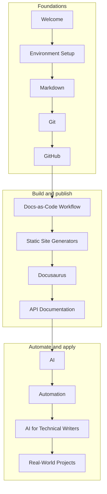

# Learning Roadmap

This roadmap shows the complete learning journey, from your first setup to a published, AI-assisted documentation portfolio. Work through the modules in order. Each module builds on the one before it, and each one ends with something you can check or publish.

---

## How to Use This Roadmap

- Follow the modules in order. The prerequisites in each module assume the earlier ones.
- Each module has its own overview page, with learning objectives, prerequisites, and a "Next Lesson" link at the bottom.
- Time varies with your experience. Plan for more time on the modules that install tools or set up a site.
- Keep a single project folder and commit your work as you go. The final project depends on it.

---

## The Journey at a Glance

```mermaid
flowchart LR
    M1[1 Welcome] --> M2[2 Environment Setup]
    M2 --> M3[3 Markdown]
    M3 --> M4[4 Git]
    M4 --> M5[5 GitHub]
    M5 --> M6[6 Docs-as-Code Workflow]
    M6 --> M7[7 Static Site Generators]
    M7 --> M8[8 Docusaurus]
    M8 --> M9[9 API Documentation]
    M9 --> M10[10 AI]
    M10 --> M11[11 Automation]
    M11 --> M12[12 AI for Technical Writers]
    M12 --> M13[13 Real-World Projects]
```

The journey has three stages:

---

## Module 1 · Welcome

Understand what Docs-as-Code is, why organizations adopt it, and how the course is structured.

- What is Docs-as-Code?
- Why Docs-as-Code?
- Learning Roadmap

---

## Module 2 · Environment Setup

Install and verify the tools you will use throughout the course.

- Install Git
- Install GitHub
- Install VS Code
- Install Cursor
- Install Claude Code
- Install Python
- Install Docker
- Install Node.js
- Verify Installation

---

## Module 3 · Markdown

Learn how to write clear, structured technical content in plain text.

- Basics
- Best Practices
- Frontmatter
- Headings, lists, and tables
- Links and images
- Code blocks and callouts
- Mermaid diagrams

---

## Module 4 · Git

Version control from beginner to advanced: track, compare, and restore documentation.

- Repositories and cloning
- Commits and branches
- Merge and rebase
- Stash and tags
- Undo changes
- Cheat sheet

---

## Module 5 · GitHub

Work with repositories and collaborate through GitHub.

- Repository management
- Issues and discussions
- Pull requests
- Projects and releases
- GitHub Actions
- Security settings

---

## Module 6 · Docs-as-Code Workflow

Apply the documentation lifecycle, branching strategy, versioning, and review process.

- Documentation lifecycle
- Branching strategy
- Review workflow
- Versioning and releases
- Best practices

---

## Module 7 · Static Site Generators

Compare the tools that turn Markdown into a website, and choose one for your project.

- Comparison of generators
- Docusaurus
- MkDocs
- GitBook
- Mintlify
- Document360

---

## Module 8 · Docusaurus

Build, customize, and deploy the documentation site used throughout this course.

- Why Docusaurus, and installation
- Project structure and configuration
- Sidebars, navbar, and homepage
- Static assets and themes
- React components and versioning
- Deployment to GitHub Pages
- Best practices and troubleshooting

---

## Module 9 · API Documentation

Learn the basics of APIs and document them in a standard format.

- REST APIs, HTTP, and JSON
- Examples
- OpenAPI and Swagger
- Postman

---

## Module 10 · AI

Learn how AI tools work for writers and developers, and how to use them safely.

- AI agents
- Prompt engineering
- Skills, MCP, and plugins
- Claude Code
- Commands and hooks
- Cursor
- Examples

---

## Module 11 · Automation

Automate checks and publishing, so that quality is enforced by the pipeline and not by memory.

- Automation overview
- CI/CD
- GitHub Actions
- Validation
- Spell checking
- Link checking
- Publishing

---

## Module 12 · AI for Technical Writers

Use AI across the documentation lifecycle, from drafting and review to release notes and governance.

- AI-assisted writing
- Documentation review and quality checks
- Terminology management
- Accessibility and inclusive language
- Translation and content migration
- Release notes and agentic AI
- AI governance and measuring AI work
- Case study: AI release note generator

---

## Module 13 · Real-World Projects

Apply what you have learned to complete projects that you can add to your portfolio.

- Documentation website project
- Docs-as-Code project
- API documentation project
- AI documentation project
- Release notes automation
- Portfolio development

---

## Beyond the Modules

- **Appendix:** books, certifications, cheat sheets, CLI commands, interview questions, and resources
- **Glossary:** shared terms used across the course, in one place

---

## Goal

At the end of this roadmap, you will have built and published a complete Docs-as-Code documentation website, used AI safely in your documentation workflow, and assembled a portfolio that shows your work.
