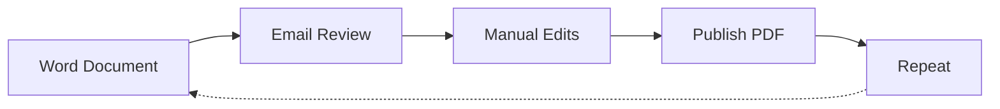
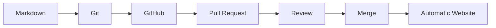
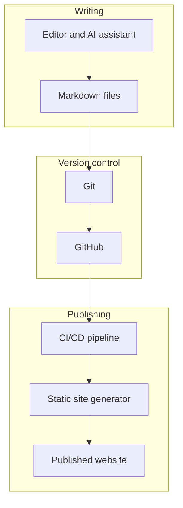
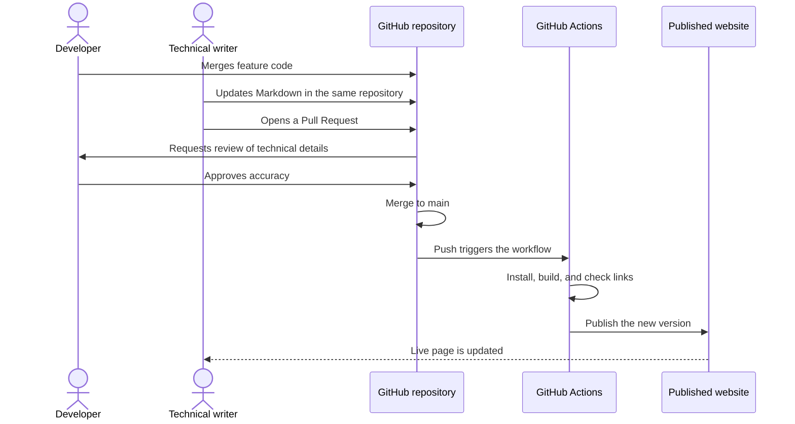

# What is Docs-as-Code?

## Learning Objectives

After completing this lesson, you will be able to:

- Define Docs-as-Code
- Explain how Docs-as-Code differs from traditional documentation
- Understand the core tools used in Docs-as-Code
- Describe the documentation workflow
- Explain why Docs-as-Code matters in an AI-assisted workplace

---

## What is Docs-as-Code?

Docs-as-Code is an approach to creating, reviewing, versioning, and publishing documentation using the same tools and workflows that software developers use for source code.

Instead of writing documentation in traditional word processors, documentation is written as plain text (usually Markdown), stored in Git repositories, reviewed through Pull Requests, and automatically published.

The core idea is simple: **documentation is a product, and it deserves the same engineering discipline as the software it describes.** Documentation lives next to the code, changes through the same review process, and is built and published by a pipeline instead of by hand.

### The Four Principles

| Principle | What it means in practice |
|---|---|
| Plain text | Content is stored as Markdown or another text format that any editor can open and Git can compare line by line. |
| Version control | Every change is recorded with an author, a date, and a reason, and any earlier version can be restored. |
| Review before publishing | Changes go through a Pull Request, where a reviewer can comment, request changes, and approve. |
| Automation | A pipeline builds, checks, and publishes the documentation, so people do not copy files by hand. |

---

## Traditional Documentation

Typical workflow:

Common challenges include:

- Multiple document versions
- Difficult collaboration
- Limited version history
- Manual publishing
- Poor traceability

Each step depends on a person, so the process slows down as the team and the product grow. Edits made in one copy are often lost when another copy is sent back, and nobody can easily tell which version a customer is reading.

---

## Docs-as-Code Workflow

Benefits include:

- Version control
- Collaborative reviews
- Automated publishing
- Documentation history
- Improved quality
- Faster updates

### What Happens at Each Step

| Step | Who is involved | What is checked or produced |
|---|---|---|
| Markdown | Writer | The content, written in plain text |
| Git | Writer | A saved, timestamped change on a separate branch |
| GitHub | Team | A shared home for the repository and its history |
| Pull Request | Writer and reviewer | A proposed change, with a description and comments |
| Review | Reviewer and subject matter expert | Accuracy, clarity, style, and links |
| Merge | Maintainer | The approved change joins the main branch |
| Automatic Website | Pipeline | The site is built and published with no manual upload |

---

## Core Components

- Markdown
- Git
- GitHub
- Static Site Generator
- CI/CD
- Automation

### How the Components Fit Together

| Component | Role | Example tools |
|---|---|---|
| Markdown | The format for writing content | Any text editor, VS Code, Cursor |
| Git | Records and restores every change | Git command line, GitHub Desktop |
| GitHub | Hosts the repository, reviews, and issues | GitHub, GitLab, Azure DevOps |
| Static Site Generator | Turns Markdown into a website | Docusaurus, MkDocs, Hugo, Mintlify |
| CI/CD | Runs the build and publishes automatically | GitHub Actions, Azure Pipelines |
| Automation | Runs checks such as links, spelling, and style | Scripts, linters, and API validators |

---

## Roles in a Docs-as-Code Team

Docs-as-Code changes who does what. It does not remove the need for people.

| Role | Responsibility |
|---|---|
| Technical writer | Plans the structure, writes and edits content, and owns quality |
| Developer | Supplies technical detail, reviews accuracy, and updates docs with code changes |
| Subject matter expert | Confirms technical details and approves content in their area |
| Reviewer | Checks clarity, style, and correctness before merge |
| Maintainer | Manages the pipeline, the repository settings, and publishing |

---

## Common Misconceptions

| Misconception | The reality |
|---|---|
| "Docs-as-Code means writers must learn to code." | Writers mainly need Markdown and Git basics. Programming is not required to write and review content. |
| "Docs-as-Code is only for developer documentation." | The same approach works for user guides, release notes, policies, and internal knowledge. |
| "Automation removes the need for review." | Automation checks format and links. People still check accuracy, tone, and whether the content helps the reader. |
| "Once it is in Git, the docs are correct." | Version control records changes. It does not verify facts. |

---

## Why It Matters Today

AI tools can draft documentation in seconds. That speed is useful only if the output is accurate, reviewed, and published safely. Docs-as-Code gives teams the structure to use AI responsibly:

- **Clear sources:** AI works from versioned files, so you can see what it was given and what it changed.
- **Reviewable output:** A drafted page goes through the same Pull Request review as any other change.
- **Repeatable checks:** Links, formatting, and build errors are caught by the pipeline, not by a reader.
- **Governance:** Rules such as "AI output is not published without human approval" can be written down and enforced in the process.

The skill that matters most is not the tool. It is knowing how to structure information, how to check it, and when AI can be trusted with a task.

---

## Real-World Example

A developer completes a new feature.

The documentation writer updates the Markdown file in the same repository.

A Pull Request is created.

The documentation is reviewed.

GitHub Actions automatically builds and publishes the website.

No manual publishing is required.

---

## Summary

Docs-as-Code treats documentation as a software project, enabling collaboration, automation, consistency, and continuous improvement.

It works because each change is plain text, versioned, reviewed, and published by a pipeline. Those same properties make it a safe foundation for AI-assisted writing.

---

## Next Lesson

[Why-Docs-as-Code](Why-Docs-as-Code.md)
