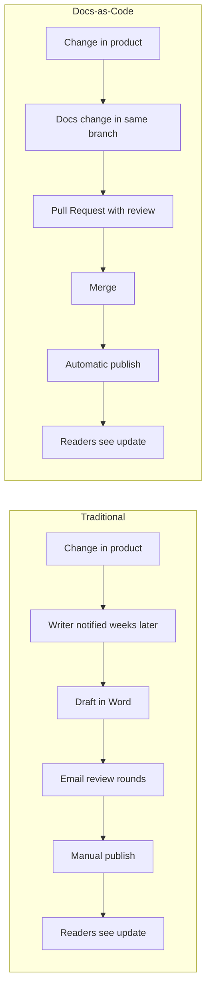
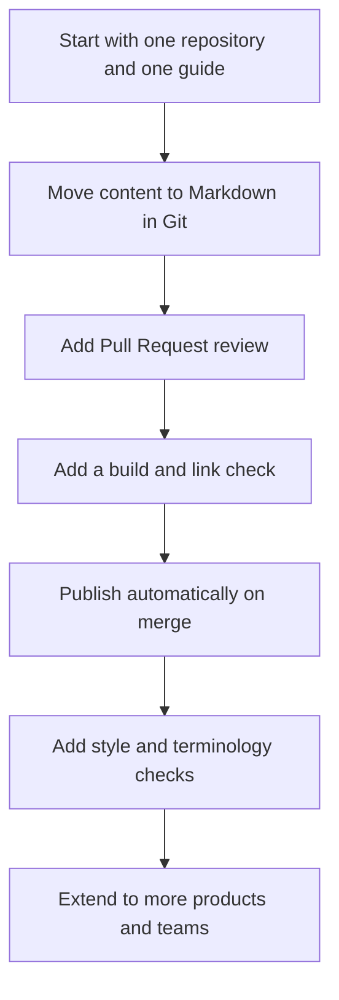

# Why Docs-as-Code?

## Learning Objectives

After completing this lesson, you will understand:

- Why organizations are adopting Docs-as-Code
- The benefits for technical writers and development teams
- Common challenges solved by Docs-as-Code
- The trade-offs and limits of the approach
- How to measure whether Docs-as-Code is working

---

## Why Change?

Software changes rapidly.

Documentation must keep pace.

Traditional documentation processes often rely on manual updates, disconnected review cycles, and multiple document versions. This makes it difficult to maintain accurate, up-to-date content.

Docs-as-Code addresses these challenges by integrating documentation into the software development lifecycle.

The cost of out-of-date documentation is real. A customer who follows a steps-based guide that no longer matches the product loses time, opens a support ticket, or gives up. A developer who cannot find an API parameter guesses, and sometimes guesses wrong. Keeping documentation in step with the product is a quality problem, not only a publishing problem.

### The Feedback Loop

The biggest difference is how quickly a change moves from idea to reader.

In the traditional loop, the documentation update often arrives after the release. In the Docs-as-Code loop, the documentation change can be reviewed in the same Pull Request as the code change, so the two can ship together.

---

## Benefits

### Better Collaboration

Technical writers and developers work in the same repository using shared workflows.

Writers can see the code that a feature changes, and developers can see the documentation that describes it. Questions get answered in the Pull Request, where the context already exists.

### Version Control

Every change is tracked, making it easy to review history, compare versions, and restore previous content when needed.

Version control also answers questions that were hard to answer before: who changed a warning, when a procedure changed, and which release a customer's version of the guide came from.

### Faster Reviews

Documentation changes are reviewed using Pull Requests, allowing comments, approvals, and discussions before publishing.

Reviewers can comment on a specific line, suggest a change, and approve or request changes in one place. Email threads with attachments are replaced by a single, traceable discussion.

### Automation

Build, validate, and publish documentation automatically using CI/CD pipelines.

A pipeline can check links, build the site, and catch formatting errors on every change. The reader never sees a broken page that a machine could have caught.

### Consistency

Templates, style guides, and automated checks help maintain consistent documentation across projects.

Shared templates and a single style guide make pages look and read the same. Checks for terminology and spelling can run on every change, instead of depending on one person's memory.

### Scalability

Docs-as-Code supports small projects as well as large documentation sites with thousands of pages.

The same tools work for a one-page README and for a site with multiple products, versions, and languages. Content can be split into folders and sites as the project grows.

### For Technical Writers

- Work in an editor you already use, with plain text that is easy to search and reuse
- Show your contribution through commits and merged Pull Requests
- Join the same review conversations as engineers, which builds technical credibility
- Learn skills that carry across tools, such as Git, Markdown, and CI/CD

### For Development Teams

- Documentation updates ship with the code they describe
- Fewer surprises for users and support teams
- Shared ownership of accuracy, instead of a separate documentation queue
- Automated checks that protect the quality of the docs without extra meetings

---

## Comparison

| Traditional Documentation | Docs-as-Code |
|----------------------------|--------------|
| Word processors | Markdown |
| Shared folders | Git repositories |
| Email reviews | Pull Requests |
| Manual publishing | Automated publishing |
| Multiple copies | Single source of truth |
| Limited history | Complete version history |
| Reviews after the draft is finished | Reviews on each small change |
| Format checked by eye | Format checked by tools |
| Publishing depends on one person | Publishing runs from a pipeline |
| Hard to link to code changes | Documentation and code share a branch |

---

## Challenges Docs-as-Code Solves

| Challenge | How Docs-as-Code helps |
|-----------|------------------------|
| Documentation falls behind the product | Docs changes travel with code changes in the same Pull Request |
| Several versions of the same guide | One source in Git, with history and tags for each release |
| Reviews get lost in email | Comments and approvals stay attached to the exact line |
| Broken links reach readers | The build can fail when a link is broken |
| Publishing is slow and manual | A pipeline publishes the site on each merge |
| Writers and engineers work apart | Both work in the same repository and the same review process |
| Nobody knows who changed what | Each change has an author, a date, and a message |

---

## Trade-offs and Limits

Docs-as-Code is not free of cost. A fair view includes the downsides.

| Trade-off | What it means |
|-----------|---------------|
| Learning curve | Writers need basic Git, Markdown, and Pull Request skills |
| Tool setup | A site generator, a pipeline, and a repository must be set up and maintained |
| Review discipline | Pull Requests only help if reviewers respond in a reasonable time |
| Non-technical contributors | Some subject matter experts find Git hard, so they need another way to contribute |
| Layout limits | Plain Markdown may not cover complex print layouts or highly designed brochures |
| Ownership | Someone must own the pipeline, the templates, and the style rules |

A team with no developers, no need for a website, and content that is mostly printed may not need this approach. The question is whether the benefits outweigh the setup cost for your project.

---

## Why It Matters in the AI Era

AI tools can draft documentation in seconds. Speed is only useful when the output is accurate, reviewed, and published safely. Docs-as-Code provides the structure that makes AI use manageable.

- **Traceable inputs:** Versioned files show what the AI was given and what it changed.
- **Reviewable output:** An AI draft goes through the same Pull Request review as any other change.
- **Repeatable checks:** Links, formatting, and build errors are caught by the pipeline.
- **Clear rules:** Policies such as "AI drafts need human approval before merge" can be written into the process.

---

## Industries Using Docs-as-Code

- Software Development
- Cloud Platforms
- DevOps
- Open Source Projects
- API Providers
- SaaS Companies

Docs-as-Code is also used in regulated and enterprise settings, where audit trails and approval records matter. Teams in these settings typically add stricter review rules and access controls on top of the same workflow.

---

## Adoption Path

Teams rarely switch everything at once. A practical path looks like this:

Each step is small, and each one gives a visible benefit before the next step starts.

---

## Measuring Success

Choose a few measures before you start, and measure them again after each change.

| Measure | What it tells you |
|---------|-------------------|
| Time from code change to published docs | Whether documentation keeps pace with the product |
| Number of broken links found before publishing | Whether automated checks are working |
| Pull Request review time | Whether reviews are a bottleneck |
| Number of support tickets about a topic | Whether the content answers real questions |
| Number of pages updated per release | Whether documentation is part of each release |

Measure the trend over time rather than a single number.

---

## Summary

Docs-as-Code improves collaboration, traceability, automation, and documentation quality by adopting software development practices for documentation.

It is not free. It asks writers to learn new tools and teams to keep the pipeline healthy. In return, documentation can keep pace with the product, and the review and publishing steps become repeatable and measurable.

---

## Next Lesson

[Environment Setup](../01-Environment-Setup/README.md)
