# Creating Diagrams with Mermaid

> **Estimated reading time:** 25 minutes

## Learning Objectives

After completing this lesson, you will be able to:

- Understand what Mermaid is and when to use it.
- Create flowcharts to show processes and workflows.
- Create sequence diagrams to show interactions.
- Create class diagrams to show object structures.
- Create state diagrams to show state transitions.
- Write Mermaid syntax correctly.
- Apply best practices for clear and accessible diagrams.
- Embed Mermaid diagrams in your documentation.
- Use Mermaid in your Docs-as-Code workflow.

---

## What is Mermaid?

Mermaid is a JavaScript-based diagramming and charting tool that uses Markdown-inspired syntax to create diagrams. It allows you to describe diagrams with simple text instead of drawing tools.

Mermaid is widely used for:

- Flowcharts
- Sequence diagrams
- Class diagrams
- State diagrams
- Entity-relationship diagrams
- Git graphs
- Pie charts

---

## Why Use Mermaid in Documentation?

Mermaid offers many benefits for Docs-as-Code projects.

**Benefits:**

- Write diagrams with code. Diagrams live in your repository alongside documentation.
- Version control. Track changes to diagrams using Git.
- No special tools required. Create diagrams with a text editor.
- Responsive. Diagrams automatically scale for different screen sizes.
- Accessible. Text-based diagrams can be read by screen readers.
- Maintainable. Update diagrams by editing text, not redrawing.
- Consistent styling. All diagrams look professional and uniform.
- Fast rendering. Diagrams render instantly in the browser.

---

## Basic Mermaid Syntax

All Mermaid diagrams follow this structure:

```markdown
\`\`\`mermaid
diagram type
  [diagram content]
\`\`\`
```

Mermaid diagrams are written inside a code fence with the language set to `mermaid`.

### Example: Simple Flowchart

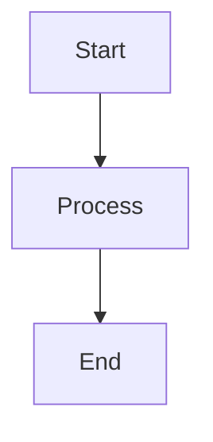

---

## Flowcharts

Flowcharts show the flow of a process or workflow. They use shapes and arrows to represent steps and decisions.

### Flowchart Syntax

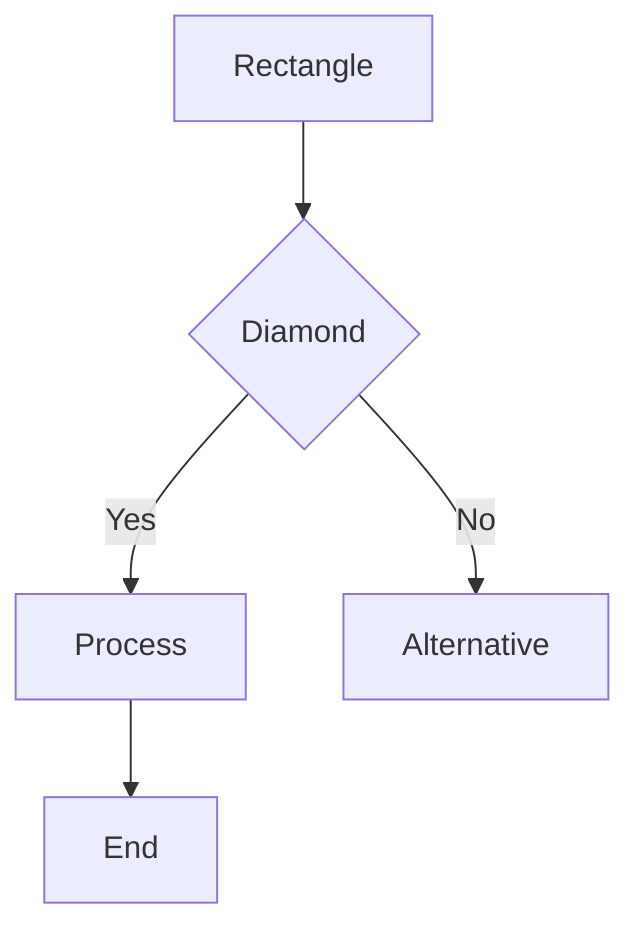

### Flowchart Shapes

| Shape | Syntax | Use Case |
|-------|--------|----------|
| Rectangle | `[text]` | Process or action |
| Diamond | `{text}` | Decision or question |
| Circle | `((text))` | Start or end point |
| Oval | `([text])` | Alternative process |
| Trapezoid | `[/text\]` | Input or output |

### Flow Directions

Control the diagram direction:

- `TD` - Top to Down (default)
- `LR` - Left to Right
- `RL` - Right to Left
- `BT` - Bottom to Top

### Example: User Registration Process

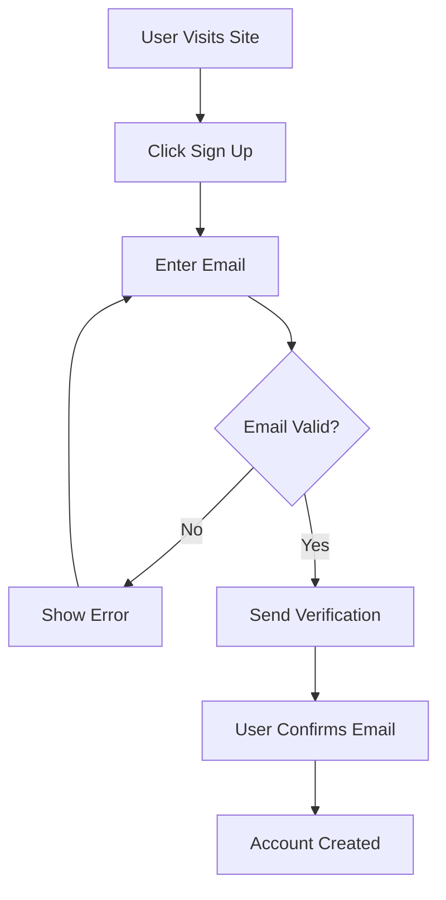

---

## Sequence Diagrams

Sequence diagrams show interactions between actors over time. They display the order and timing of messages between participants.

### Sequence Diagram Syntax

```mermaid
sequenceDiagram
    Actor A->>Actor B: Message
    Actor B-->>Actor A: Response
```

### Sequence Diagram Elements

- `-->` - Solid arrow (synchronous call)
- `-->>` - Dashed arrow (return or asynchronous)
- `activate` - Highlight active participants
- `deactivate` - End highlighting
- `par` - Parallel execution
- `alt` - Alternative flows

### Example: API Request Flow

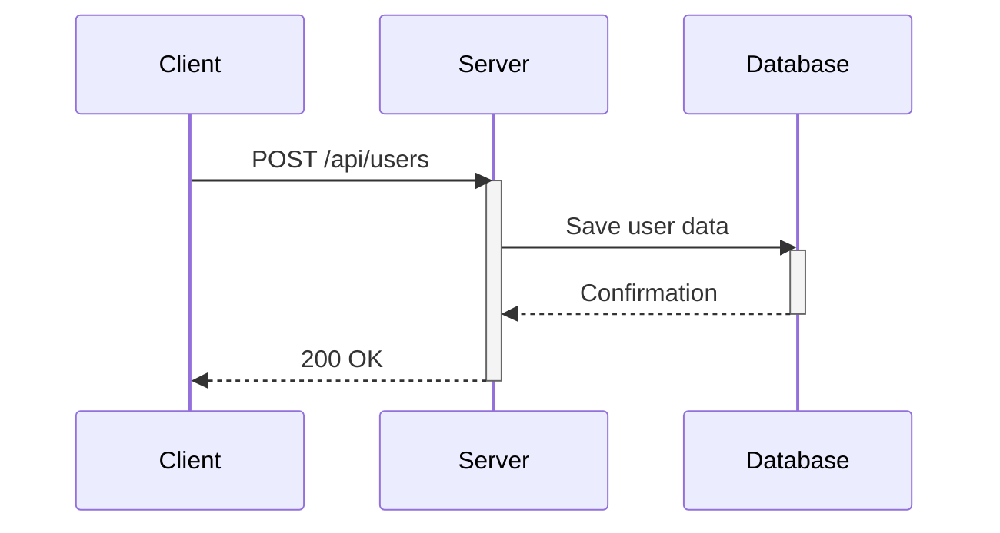

---

## Class Diagrams

Class diagrams show the structure of objects and their relationships. They display classes, properties, methods, and inheritance.

### Class Diagram Syntax

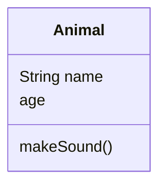

### Class Diagram Relationships

- `--` - Association
- `<|--` - Inheritance
- `*--` - Composition
- `o--` - Aggregation
- `-->` - Dependency

### Example: E-Commerce System

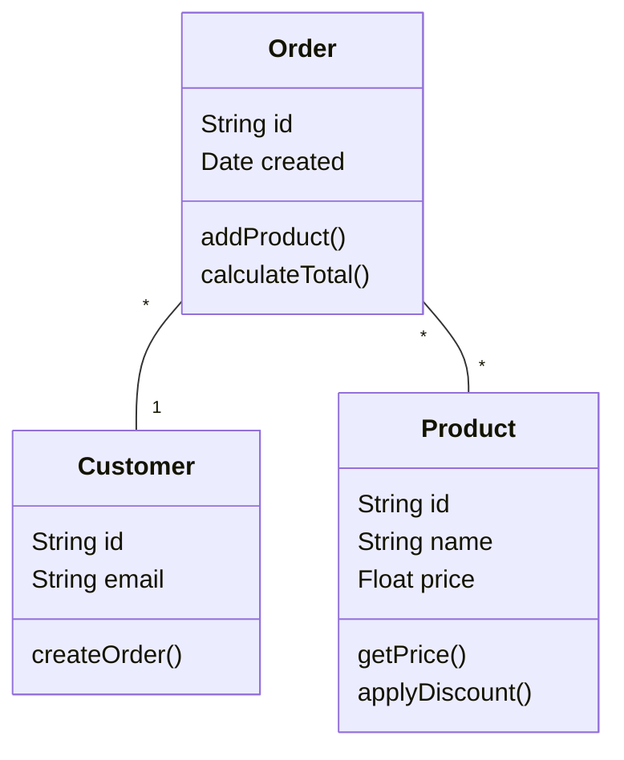

---

## State Diagrams

State diagrams show how an entity transitions between different states. They display states and the events that trigger transitions.

### State Diagram Syntax

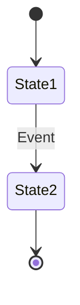

### State Diagram Elements

- `[*]` - Start or end state
- `-->` - Transition
- `:` - Event that triggers transition
- `state X { ... }` - Nested states

### Example: Document Workflow

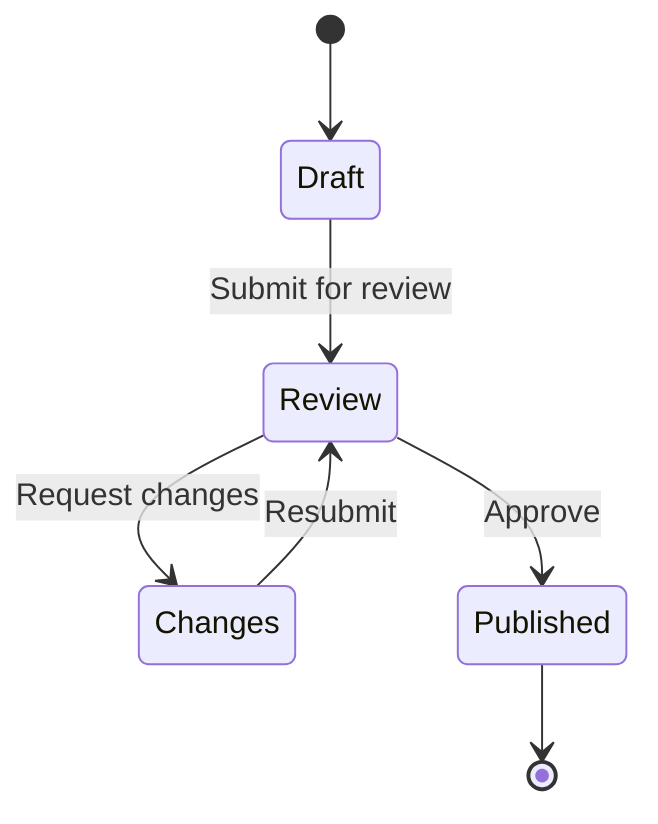

---

## Entity-Relationship Diagrams

Entity-relationship (ER) diagrams show how entities relate to each other in a database.

### ER Diagram Syntax

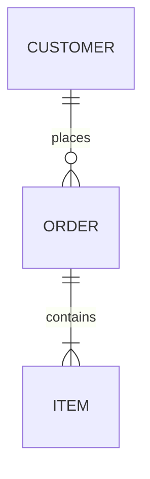

### ER Diagram Relationships

- `|o` - Zero or one
- `||` - Exactly one
- `o{` - Zero or many
- `|{` - One or many

### Example: Blog Database

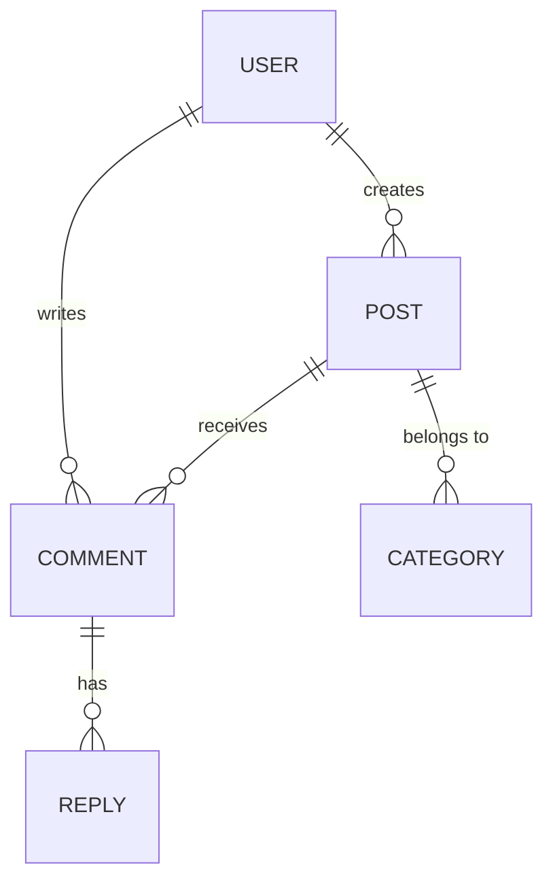

---

## Git Graphs

Git graphs visualize branching and merging in version control workflows.

### Git Graph Syntax

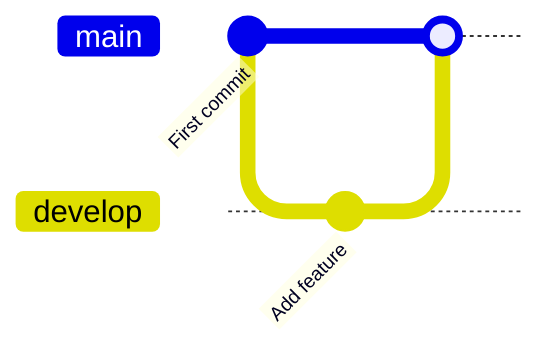

### Example: Feature Branch Workflow

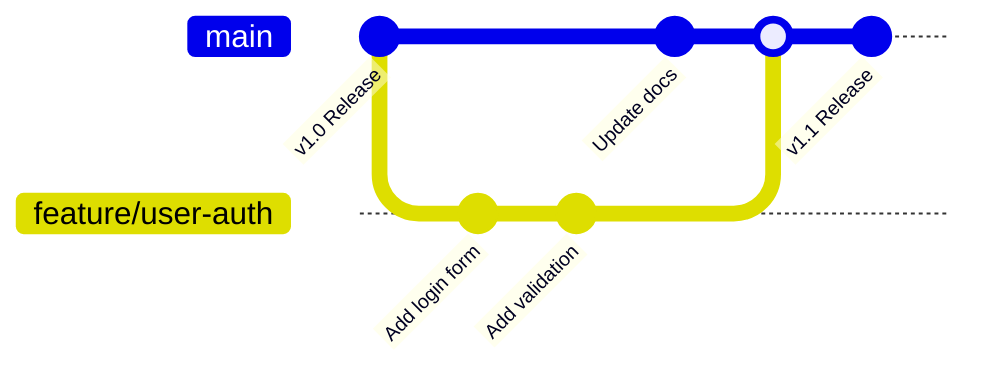

---

## Best Practices for Mermaid Diagrams

### Keep Diagrams Simple

- Avoid overcomplicated flows. Break complex processes into smaller diagrams.
- Limit the number of shapes. Too many shapes make diagrams hard to read.
- Use clear labels. Make sure every shape and arrow has a clear label.

### Use Consistent Styling

- Use the same shape types for similar elements.
- Use consistent arrow labels and directions.
- Keep the diagram aligned and balanced.

### Write Clear Text

- Use descriptive labels. "User clicks Submit" is better than "Click".
- Use proper capitalization. Capitalize the first word of each label.
- Keep text short. Use brief phrases, not long sentences.

### Choose the Right Diagram Type

- Flowcharts: Show processes and workflows.
- Sequence diagrams: Show interactions and timing.
- Class diagrams: Show object structures and relationships.
- State diagrams: Show state transitions.
- ER diagrams: Show database relationships.

### Make Diagrams Accessible

- Add alt text when you place diagrams in documentation.
- Use descriptive labels that make sense without the diagram.
- Avoid using color alone to convey information.
- Provide a text description of complex diagrams.

### Test Your Mermaid Code

- Use the Mermaid Live Editor to test diagrams before adding to documentation.
- Verify the diagram renders correctly in your browser.
- Check that all labels are visible and readable.

---

## Embedding Mermaid in Documentation

### In Markdown Files

Write the Mermaid code inside a code fence:

```markdown
\`\`\`mermaid
flowchart LR
    A[Start] --> B[Process] --> C[End]
\`\`\`
```

### In Docusaurus

Docusaurus supports Mermaid by default. Simply use the mermaid code fence.

### In Jekyll

Add Mermaid support by including the script in your layout:

```html
<script src="https://cdn.jsdelivr.net/npm/mermaid/dist/mermaid.min.js"></script>
<script>mermaid.initialize({ startOnLoad: true });</script>
```

### In MkDocs

Install the MkDocs Mermaid plugin:

```bash
pip install mkdocs-mermaid2-plugin
```

Then add to `mkdocs.yml`:

```yaml
plugins:
  - mermaid2
```

---

## Common Mermaid Patterns in Documentation

### Installation Steps

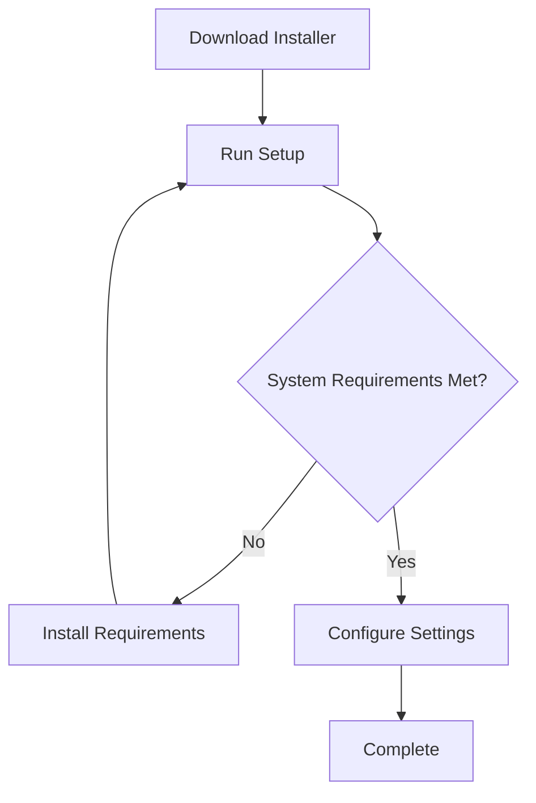

### API Request-Response Cycle

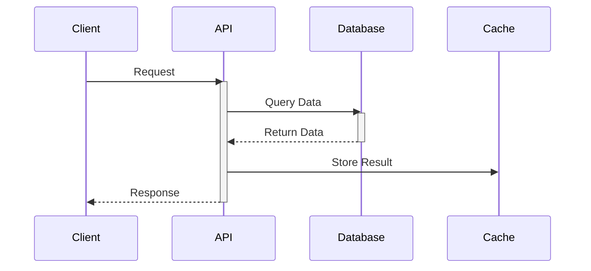

### Bug Lifecycle

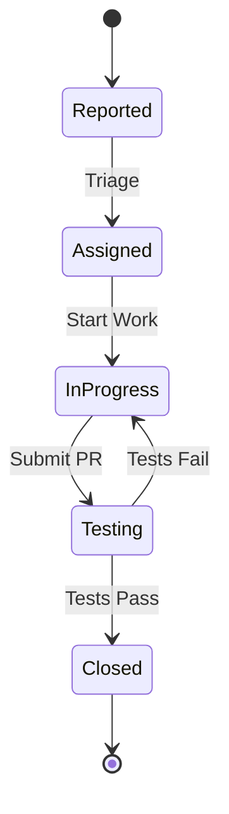

---

## Troubleshooting Mermaid Diagrams

### Diagram Not Rendering

**Problem:** Diagram code fence has errors.

**Solution:**

- Check for typos in diagram keywords.
- Verify parentheses and brackets match.
- Use the Mermaid Live Editor to debug.

### Text Not Visible

**Problem:** Labels or text are cut off.

**Solution:**

- Shorten labels.
- Use line breaks for long text: `["Line 1<br/>Line 2"]`
- Adjust the diagram direction.

### Diagram Too Large

**Problem:** Diagram is too wide or tall for the page.

**Solution:**

- Simplify the diagram.
- Break into smaller diagrams.
- Use a different diagram type.

---

## Resources for Learning Mermaid

- **Mermaid Live Editor:** https://mermaid.live - Test and preview diagrams online.
- **Official Documentation:** https://mermaid.js.org - Complete syntax reference.
- **Diagram Examples:** Browse existing diagrams for inspiration.

---

## Best Practices Summary

- Use Mermaid for processes, workflows, and relationships.
- Keep diagrams simple and readable.
- Use descriptive labels.
- Choose the right diagram type for your information.
- Test diagrams before publishing.
- Add alt text and descriptions for accessibility.
- Version control your diagrams with Git.
- Maintain consistent styling across all diagrams.

---

## Summary

In this lesson, you learned how to:

- Create flowcharts for processes and workflows.
- Create sequence diagrams for interactions.
- Create class, state, and ER diagrams.
- Write correct Mermaid syntax.
- Embed Mermaid diagrams in your documentation.
- Follow best practices for clear and accessible diagrams.

Mermaid diagrams make technical documentation clearer and more engaging. Practice creating different diagram types.

---

## Exercise

1. Create a Mermaid flowchart showing a process you know (login, checkout, approval, etc.).
2. Create a Mermaid sequence diagram showing interactions between two systems.
3. Create a Mermaid state diagram showing a workflow or status progression.
4. Test each diagram in the Mermaid Live Editor.
5. Add the diagrams to a Markdown file in your documentation.
6. Commit the changes to Git.

---

## Knowledge Check

**Question 1**

What is Mermaid used for in documentation?

- A. Styling web pages ❌
- B. Creating diagrams with text-based syntax ✅
- C. Writing code blocks ❌
- D. Generating PDF files ❌

---

**Question 2**

Which diagram type shows interactions between systems over time?

- A. Flowchart ❌
- B. Class diagram ❌
- C. Sequence diagram ✅
- D. State diagram ❌

---

**Question 3**

What does the diamond shape represent in a flowchart?

- A. Process or action ❌
- B. Start or end point ❌
- C. Decision or question ✅
- D. Input or output ❌

---

**Question 4**

Which of these is correct Mermaid syntax for a flowchart?

- A. `flowchart LR: A --> B` ❌
- B. `flowchart LR` then `A --> B` ✅
- C. `flow: A --> B` ❌
- D. `diagram LR A --> B` ❌

---

## Next Lesson

➡️ [Tables](Tables.md)
