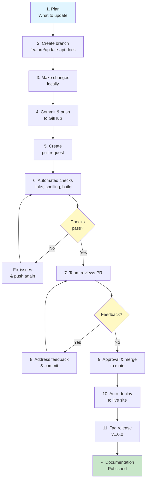

# Docs-as-Code Best Practices

> **Estimated reading time:** 25 minutes

## Learning Objectives

After completing this lesson, you will be able to:

- Understand core principles of Docs-as-Code.
- Plan a Docs-as-Code implementation from scratch.
- Establish team roles and workflows.
- Maintain documentation quality and consistency.
- Build sustainable documentation practices.
- Implement automation and checks.
- Scale documentation with your organization.
- Avoid common pitfalls and mistakes.

---

## What Is Docs-as-Code?

Docs-as-Code means treating documentation like software code.

### Core Principles

**Version Controlled:**
- Documentation in Git repository
- Track every change
- Full history preserved
- Easy to revert mistakes

**Collaborative:**
- Multiple people contribute
- Code review process for changes
- Team knowledge sharing
- Transparent workflow

**Automated:**
- Builds run automatically
- Quality checks enforce standards
- Tests verify examples
- Deployments are automated

**Reproducible:**
- Anyone can build documentation locally
- Same output every time
- Clear instructions for setup
- No "works on my machine" problems

### What It's NOT

**NOT a replacement for technical writers:**
- Writers still essential
- Better tools, same skills needed
- Focuses on process, not talent

**NOT harder than traditional documentation:**
- Once set up, easier to maintain
- Automation saves time
- Team collaboration smoother
- Changes easier to track

:::important

Docs-as-Code is about treating documentation professionally, like code, with processes, reviews, and quality standards.

:::

---

## Before You Start

Make sure you have:

- Team commitment to documentation
- Access to create Git repository
- Understanding of basic Git concepts
- Time to invest in setup (1-2 weeks)
- Long-term perspective (this is sustainable, not quick)

:::note

**For Beginners**

Docs-as-Code takes effort to set up. But the investment pays back quickly through easier maintenance and collaboration.

:::

---

## Planning Your Docs-as-Code Implementation

### Step 1: Assess Current State

**Evaluate your situation:**

- Where is documentation currently stored? (Google Docs, Wiki, scattered?)
- Who owns documentation?
- How often is documentation updated?
- What's the biggest pain point?
- How many people need to contribute?

**Example assessment:**

```
Current State:
- Documentation in Google Docs
- Only 2 people write docs
- Takes 2 weeks to update docs for release
- Links often broken after reorganization
- No way to version documentation
- Hard to track who changed what

Pain Points:
- Can't see what changed when
- No review process - errors get published
- Inconsistent formatting
- Hard for new people to contribute
- Breaking changes in docs not tracked
```

### Step 2: Define Your Goals

**What do you want to achieve?**

- Faster documentation updates
- Better quality and consistency
- More team members contributing
- Automated publishing
- Version control and history
- Reduced time to maintain

**Prioritize top 3-5 goals.**

Example goals:
1. Enable team members to easily contribute
2. Catch documentation errors before publishing
3. Automate building and deploying documentation
4. Maintain documentation versions
5. Track documentation changes over time

### Step 3: Choose Your Tech Stack

**Documentation Format:**
- Markdown (recommended - simple, widely supported)
- AsciiDoc (more powerful)
- reStructuredText (Python-focused)

**Build Tool:**
- Docusaurus (recommended for getting started)
- Hugo (fast, flexible)
- MkDocs (Python-focused)
- Sphinx (Python documentation standard)

**Hosting:**
- GitHub Pages (free, built-in)
- Netlify (automatic deployments, free tier)
- AWS S3 (more control, costs money)

**Recommendation for starting out:**
- Format: Markdown
- Build: Docusaurus or MkDocs
- Hosting: GitHub Pages
- Repository: GitHub

This stack is free, well-documented, and easy to learn.

### Step 4: Plan Phased Implementation

**Phase 1 (Week 1-2): Setup Foundation**
- Create Git repository
- Set up folder structure
- Configure build tool
- Deploy to hosting
- Set up GitHub Actions for automation

**Phase 2 (Week 3-4): Migrate Content**
- Convert existing docs to Markdown
- Organize in folder structure
- Test all links work
- Validate all examples

**Phase 3 (Week 5-6): Establish Workflow**
- Create CONTRIBUTING.md
- Set up review process
- Train team on workflow
- Create templates

**Phase 4 (Ongoing): Optimize & Scale**
- Gather feedback
- Improve automation
- Add new features
- Expand documentation

:::tip

Don't try to do everything at once. Phased implementation reduces risk and builds team confidence.

:::

---

## Team Roles and Responsibilities

### Define Clear Roles

**Documentation Manager:**
- Owns documentation strategy
- Sets quality standards
- Reviews major changes
- Trains team
- Manages timeline

**Senior Technical Writer:**
- Maintains style guide
- Reviews contributions
- Mentors new writers
- Handles architecture decisions

**Technical Writers:**
- Write and maintain sections
- Review peer contributions
- Suggest improvements
- Contribute to team processes

**Subject Matter Experts (Optional):**
- Provide technical input
- Review accuracy
- Answer questions

### Responsibility Matrix

| Task | Manager | Sr. Writer | Writers | SME |
|------|---------|-----------|---------|-----|
| Set standards | ✓ | ✓ |  |  |
| Write docs |  | ✓ | ✓ | ✓ |
| Review PRs | ✓ | ✓ | ✓ |  |
| Approve merges | ✓ | ✓ |  |  |
| Deploy docs | ✓ |  |  |  |
| Update processes |  | ✓ |  |  |

Make responsibilities clear so no one is confused about who does what.

:::note

**Documentation Manager's Tip**

Clear roles prevent confusion and ensure accountability. Discuss and document roles before starting.

:::

---

## Documentation Workflow

### Typical Docs-as-Code Workflow



### How-To: Make Your First Documentation Change

**Step 1: Clone the repository**

```bash
git clone https://github.com/your-org/documentation.git
cd documentation
```

**Result:** You now have local copy of all documentation.

**Step 2: Create a feature branch**

```bash
git switch -c feature/add-getting-started-guide
```

**Result:** You're on a new branch where you can make changes safely.

**Step 3: Create or edit documentation**

Create new file: `docs/getting-started/installation.md`

```markdown
# Installation Guide

## Prerequisites
- Node.js 18 or higher
- npm or yarn package manager

## Installation Steps

1. Download the installer from our website
2. Run the installer
3. Follow the setup wizard
4. Verify installation
```

**Result:** You've created documentation content.

**Step 4: Build locally and verify**

```bash
npm run build
npm run serve
# Open http://localhost:3000 to see your changes
```

**Result:** You verify your changes look correct before sharing.

**Step 5: Commit and push**

```bash
git add docs/getting-started/installation.md
git commit -m "Add installation guide with prerequisites and steps"
git push origin feature/add-getting-started-guide
```

**Result:** Your changes are on GitHub, ready for review.

**Step 6: Create pull request**

On GitHub, you'll see a prompt to "Create pull request"

Click it, add description:
```
## What
Added comprehensive installation guide

## Why
Users need clear installation instructions

## What to review
- Are steps clear and complete?
- Does it match our style guide?
- Are all links correct?
```

**Result:** Your PR is ready for team review.

**Step 7: Address feedback**

If reviewers suggest changes:
- Make changes locally
- Commit: `git commit -m "Update installation guide - address feedback"`
- Push: `git push origin feature/add-getting-started-guide`
- Reply to comments in PR

**Result:** Changes are visible in PR, conversation tracked.

**Step 8: Merge**

Once approved, click "Merge pull request"

**Result:** Your documentation is now on main branch.

**Step 9: Deploy**

GitHub Actions automatically:
- Builds documentation
- Runs checks
- Deploys to live website

**Result:** Your documentation is live for users!

---

## Quality and Consistency

### Documentation Standards

Create a style guide covering:

**Tone and Voice:**
- Use active voice: "Click the button" not "The button can be clicked"
- Friendly and approachable: "Let's get started" not "Initialization commences"
- Clear and direct: avoid jargon, explain terms

**Formatting:**
- Consistent heading hierarchy
- Code blocks with language specified
- Links to related content
- Images with alt text

**Content Structure:**
- Start with overview
- Include examples
- Provide next steps
- Link to related topics

**Example style rule:**

```markdown
❌ Bad: "The user should navigate to the settings menu."
✓ Good: "Go to Settings."

❌ Bad: "It is possible to configure the database URL via environment variables."
✓ Good: "Set your database URL using environment variables."
```

### How-To: Create a Style Guide

**Step 1: Create file**

Create: `STYLE_GUIDE.md` in repository root

**Step 2: Define standards**

```markdown
# Documentation Style Guide

## Tone
- Use active voice
- Address readers as "you"
- Be friendly and helpful
- Avoid jargon

## Headings
- Use H2 (#) for main sections
- Use H3 (##) for subsections
- Use sentence case: "Getting started", not "Getting Started"

## Code Examples
- Always specify language: \`\`\`bash, \`\`\`python, etc.
- Include what output to expect
- Use realistic examples

## Links
- Link to related topics
- Use descriptive link text, not "click here"
- Example: [Installation Guide](../install.md) not [click here](../install.md)
```

**Step 3: Train team**

- Share in first team meeting
- Link in CONTRIBUTING.md
- Review for style during PR reviews

**Result:** Documentation has consistent quality and appearance.

### Automated Quality Checks

Set up checks to enforce standards automatically:

**Link Checking:**
- Verify all links are valid
- Catch broken references

**Spell Checking:**
- Find typos automatically
- Reduce manual review time

**Format Validation:**
- Ensure Markdown is valid
- Check file naming conventions
- Verify front matter

**Build Verification:**
- Documentation builds without errors
- No broken references
- All images load

---

## Establishing Team Workflow

### Create Contributing Guidelines

File: `CONTRIBUTING.md`

```markdown
# Contributing to Our Documentation

## Getting Started

1. Fork and clone the repository
2. Create a feature branch: `git switch -c feature/my-change`
3. Make your changes
4. Commit: `git commit -m "Clear description of change"`
5. Push: `git push origin feature/my-change`
6. Create a pull request

## Before You Submit

- [ ] Followed our style guide
- [ ] All links checked
- [ ] No typos or formatting issues
- [ ] Examples work correctly
- [ ] Built locally and verified

## Review Process

1. One reviewer minimum
2. Address feedback if requested
3. Approved reviewers can merge
4. Documentation automatically deploys

## Questions?

- Check STYLE_GUIDE.md for formatting
- Ask in #documentation Slack channel
- Reach out to documentation manager
```

### Pull Request Template

Create: `.github/pull_request_template.md`

```markdown
## What's this PR about?
[Brief description]

## Why this change?
[Explain the reason]

## Files changed
- docs/file1.md
- docs/file2.md

## How to review
[What should reviewers look for?]

## Checklist
- [ ] Followed style guide
- [ ] Links verified
- [ ] No typos
- [ ] Examples tested
- [ ] Built locally and verified
```

**Result:** All PRs follow consistent format, making review easier.

---

## How-To: Set Up Your First Docs-as-Code Repository

**Step 1: Create repository on GitHub**

1. Go to GitHub.com
2. Click "New repository"
3. Name: `documentation` or `company-docs`
4. Description: "Our company documentation"
5. Public or Private (your choice)
6. Initialize with README
7. Click Create

**Step 2: Clone locally**

```bash
git clone https://github.com/your-org/documentation.git
cd documentation
```

**Step 3: Set up Docusaurus** (recommended for starting)

```bash
npx create-docusaurus@latest . --typescript --git
```

**Step 4: Create folder structure**

```
docs/
├── getting-started/
│   ├── installation.md
│   ├── first-steps.md
│   └── configuration.md
├── guides/
│   ├── best-practices.md
│   └── troubleshooting.md
└── api/
    ├── overview.md
    └── reference.md
```

**Step 5: Add first document**

Create: `docs/getting-started/installation.md`

```markdown
---
sidebar_position: 1
---

# Installation

## Prerequisites

- Node.js 18 or higher
- npm package manager

## Steps

1. Download installer
2. Run installer
3. Verify installation

## Verify

```bash
node --version
```

You should see v18.x.x or higher.
```

**Step 6: Build and test**

```bash
npm run build
npm run serve
```

Open http://localhost:3000 - your docs are live locally!

**Step 7: Deploy to GitHub Pages**

```bash
npm run deploy
```

Your documentation is now live on the internet!

**Step 8: Commit and push**

```bash
git add .
git commit -m "Initial commit: Set up Docusaurus documentation"
git push origin main
```

**Result:** You have a working Docs-as-Code setup!

---

## Common Pitfalls and How to Avoid Them

### Pitfall 1: Not Planning First

**Mistake:** Jump into tools without planning.

**Result:** Wrong setup, wasted time, team frustration.

**Prevention:**
- Take 1-2 days to plan
- Discuss with team
- Choose appropriate tools
- Document decisions

### Pitfall 2: No Style Guide

**Mistake:** Everyone writes differently, docs look inconsistent.

**Result:** Documentation feels unprofessional, confusing.

**Prevention:**
- Create style guide upfront
- Share with team
- Review for style in PRs
- Update as needed

### Pitfall 3: Insufficient Automation

**Mistake:** Manual checks, manual deployments.

**Result:** Errors slip through, deployments delayed, tedious work.

**Prevention:**
- Set up link checking
- Automate spell check
- Auto-deploy on merge
- Run build checks on PRs

### Pitfall 4: No Review Process

**Mistake:** Anyone can merge anything.

**Result:** Errors published, inconsistent quality, no accountability.

**Prevention:**
- Require PR reviews
- Designate reviewers
- Use branch protection
- Document approval process

### Pitfall 5: Documentation "Debt"

**Mistake:** Documentation created but never updated.

**Result:** Outdated docs confuse users, reduces trust.

**Prevention:**
- Schedule regular reviews
- Update when features change
- Assign documentation to person
- Mark outdated content clearly

:::warning

Docs debt accumulates fast. Prevent it by establishing maintenance practices upfront.

:::

---

## Scaling Docs-as-Code

### As Your Documentation Grows

**Start small:**
- Core documentation
- Getting started guide
- Basic API reference
- FAQ

**Expand to:**
- Tutorials and guides
- Advanced topics
- API reference
- Video transcripts
- Release notes

**Eventually:**
- Multiple versions
- Multiple languages
- Contributed by many
- Part of product

### Multi-Version Documentation

As you release new versions:

```
docs/
├── v1.0/  (old, stable)
├── v1.1/
├── v2.0/  (latest, main focus)
└── v2.1/  (next)
```

Users can access any version. You maintain 2-3 versions.

### Multiple Languages

Docusaurus supports multiple languages:

```
docs/
├── en/     (English)
├── es/     (Spanish)
├── fr/     (French)
└── zh/     (Chinese)
```

---

## Summary

In this lesson, you learned:

- What Docs-as-Code is and why it matters
- How to plan implementation
- How to establish team roles and workflows
- How to maintain quality and consistency
- How to avoid common pitfalls
- How to scale as documentation grows

Docs-as-Code is an investment that pays back through easier maintenance, better collaboration, and higher quality documentation.

---

## Exercise

1. Assess your current documentation situation
2. Define top 3-5 goals for Docs-as-Code
3. Create project timeline (4-6 weeks)
4. Identify team members and roles
5. Choose tech stack (recommend: Markdown + Docusaurus + GitHub Pages)
6. Create documentation repository
7. Set up folder structure
8. Create first 3 documents (installation, getting started, first guide)
9. Write CONTRIBUTING.md guide
10. Deploy to hosting

---

## Knowledge check

<details>
<summary><strong>1. What does Docs-as-Code mean?</strong></summary>

Docs-as-Code means treating documentation like software code: version controlled, reviewed, tested, and automated. Documentation is in a Git repository with the same collaboration and quality processes as code.

</details>

<details>
<summary><strong>2. What are the core principles of Docs-as-Code?</strong></summary>

Core principles:
- **Version Controlled** - Full Git history
- **Collaborative** - Multiple contributors with review process
- **Automated** - Builds, checks, and deployments are automatic
- **Reproducible** - Same output every time

</details>

<details>
<summary><strong>3. What's the recommended tech stack for starting Docs-as-Code?</strong></summary>

Recommended for beginners:
- **Format:** Markdown (simple, widely supported)
- **Build Tool:** Docusaurus or MkDocs
- **Hosting:** GitHub Pages (free)
- **Repository:** GitHub

This stack is free, well-documented, and easy to learn.

</details>

<details>
<summary><strong>4. What are typical roles in a Docs-as-Code team?</strong></summary>

- **Documentation Manager** - Strategy, standards, reviews, training
- **Senior Technical Writer** - Maintains standards, reviews, mentoring
- **Technical Writers** - Write and maintain sections, peer reviews
- **Subject Matter Experts** - Technical input and accuracy

</details>

<details>
<summary><strong>5. What steps are involved in making a documentation change?</strong></summary>

1. Clone repository
2. Create feature branch
3. Make changes locally
4. Build and verify locally
5. Commit and push
6. Create pull request
7. Address feedback if any
8. Merge when approved
9. Automatic deployment

</details>

<details>
<summary><strong>6. Why is a style guide important?</strong></summary>

A style guide ensures:
- Consistent tone and voice
- Consistent formatting
- Professional appearance
- Easier for team to review
- Better user experience

</details>

<details>
<summary><strong>7. What common mistakes should you avoid?</strong></summary>

Avoid:
- Not planning before starting
- No style guide (inconsistent docs)
- No automation (errors, delays)
- No review process (quality issues)
- Documentation debt (outdated docs)

</details>

<details>
<summary><strong>8. How do you plan a Docs-as-Code implementation?</strong></summary>

1. Assess current state and pain points
2. Define clear goals (top 3-5)
3. Choose tech stack
4. Plan phased implementation (4-6 weeks)
5. Define team roles
6. Establish workflow and standards
7. Execute phase by phase

</details>

---

## Next Lesson

Ready to implement Docs-as-Code? Your next step depends on your needs. Choose from:
- **Getting Started** - First-time setup guide
- **Team Collaboration** - Establishing workflows and processes
- **Quality and Standards** - Creating and maintaining style guides
- **Automation** - Setting up checks and deployments