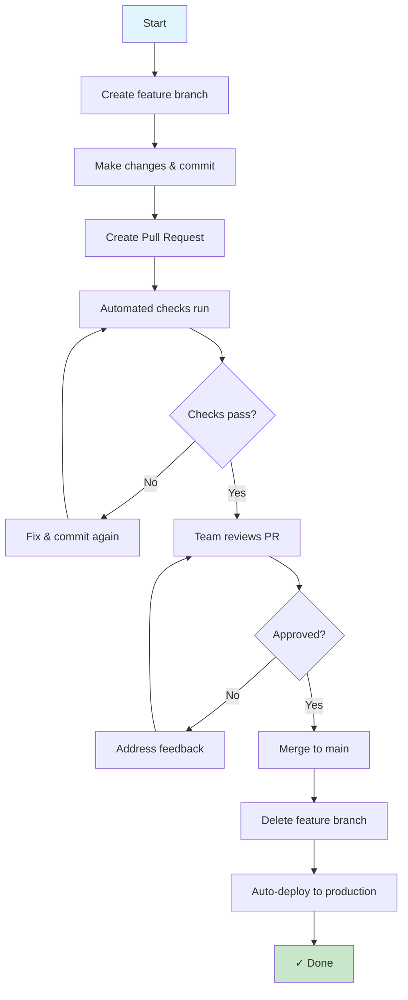

# Git Branching Strategy for Documentation

> **Estimated reading time:** 20 minutes

## Learning Objectives

After completing this lesson, you will be able to:

- Understand different branching strategies.
- Choose appropriate branching strategy for your team.
- Use consistent branch naming conventions.
- Manage documentation branches effectively.
- Handle multiple documentation versions.
- Coordinate team work without conflicts.
- Implement branching best practices.

---

## Why Branching Strategy Matters

A branching strategy is a plan for how you use Git branches. It affects:

**Team Coordination:**
- Multiple people working without conflicts
- Clear who's working on what
- Easy to track work progress

**Quality:**
- Main branch always has stable, working documentation
- Broken changes don't go live
- Easy to roll back mistakes

**Releases:**
- Clear what gets released when
- Support multiple documentation versions
- Emergency fixes can bypass normal process

**Workflow:**
- Clear process everyone follows
- New team members know what to do
- Reduces confusion and mistakes

:::important

Without a branching strategy, teams create messy, confusing repositories. A clear strategy keeps everyone organized.

:::

---

## Before You Start

Make sure you have:

- Understanding of Git branches
- Small team (2-10 people) starting out
- Documentation in Git repository
- Time to establish process (1-2 hours)

:::note

**For Beginners**

Branching strategy is about establishing a clear process. Simple strategies work best for documentation teams.

:::

---

## Common Branching Strategies

### Strategy 1: Simple Main + Feature Branches

**Best for:** Small teams, frequent releases (weekly or more often)

**How it works:**

```
main (always stable, always deployable)
  ↓
feature/add-api-docs
feature/fix-broken-link
feature/update-installation-guide
```

**Process:**

1. Create feature branch from main
2. Make changes
3. Create PR
4. Review and merge to main
5. Main automatically deploys

**Pros:**
- Simple, easy to understand
- No complicated branch management
- Everyone on same page
- Works great for small docs

**Cons:**
- Requires frequent releases
- No staging/testing environment
- All changes go live together

### Strategy 2: Git Flow

**Best for:** Large teams, scheduled releases (weekly, monthly)

**How it works:**

```
main (production releases only)
develop (integration branch)
  ↓
feature/add-guide (from develop)
release/v1.0 (final prep before release)
hotfix/fix-critical-bug (from main)
```

**Branch Types:**

- **main** - Released versions only (v1.0, v1.1, etc.)
- **develop** - Next version being worked on
- **feature/** - Individual features/changes
- **release/** - Final prep for release
- **hotfix/** - Emergency fixes for released version

**Process:**

1. Feature branches from develop
2. When enough features, create release branch
3. Final testing and fixes
4. Merge to main and tag release
5. Hotfixes come from main directly

**Pros:**
- Handles multiple versions well
- Scheduled releases work smoothly
- Clear emergency fix process
- Good for larger teams

**Cons:**
- More complex than simple strategy
- More branches to manage
- Requires discipline

### Strategy 3: Trunk-Based Development

**Best for:** Very small teams, continuous releases (daily or on-demand)

**How it works:**

```
main (always ready to release)
  ↓
short-lived feature branches (1-3 days)
```

**Process:**

1. Create short-lived feature branch
2. Make changes quickly
3. Merge within 24 hours
4. Main is always ready to deploy

**Pros:**
- Simplest strategy
- Minimal merge conflicts
- Always ready to release
- Encourages small, focused changes

**Cons:**
- Requires high-quality automation
- Team discipline needed
- Not great for planned releases

---

## Recommended Strategy for Documentation Teams

**For most documentation teams, use: Simple Main + Feature Branches**

It's:
- Easy to learn
- Handles typical documentation workflows
- Flexible enough to grow
- Minimal overhead

**Setup:**

```
main (always stable, deployed to production)
  ├── feature/add-getting-started-guide
  ├── feature/update-api-docs
  ├── feature/fix-broken-links
  └── hotfix/critical-fix (for emergency fixes)
```

**When to upgrade to Git Flow:**
- Team grows to 10+ people
- Need to support multiple documentation versions
- Release schedule is rigid (monthly)
- Need long-term testing branches

---

## Branch Naming Conventions

Consistent naming helps everyone understand branches at a glance.

### Naming Pattern

```
<type>/<short-description>
```

**Types:**

| Type | Purpose | Example |
|------|---------|---------|
| feature/ | New documentation or features | feature/add-api-authentication |
| fix/ | Bug fixes and corrections | fix/broken-link-in-installation |
| update/ | Updates to existing docs | update/refresh-getting-started |
| docs/ | Documentation meta changes | docs/update-contributing-guide |
| hotfix/ | Emergency fixes | hotfix/critical-typo-in-homepage |

### Naming Rules

- **Use lowercase** - `feature/my-branch` not `Feature/MyBranch`
- **Use dashes, not underscores** - `feature/my-change` not `feature/my_change`
- **Be descriptive** - `feature/add-deployment-guide` not `feature/new-doc`
- **Keep it short** - `feature/fix-typo` not `feature/fix-the-typo-on-line-45-of-getting-started`
- **Use issue number if available** - `feature/add-guide-#42` if you have issue #42

### Why Consistency Matters

**Good branch naming:**
```
feature/add-api-reference
fix/broken-link-troubleshooting
update/installation-guide-for-v2
```

You know immediately what each branch is for.

**Inconsistent naming:**
```
AddApiRef
fix-123
v2_install
docs-stuff
my-changes
```

Confusing, hard to find what you need.

:::tip

Set branch naming conventions in CONTRIBUTING.md so everyone follows them.

:::

---

## How-To: Implement Branching Strategy

### Step 1: Choose Your Strategy

Decision matrix:

| Your Situation | Recommended Strategy |
|---|---|
| Small team (2-5), frequent updates | Simple Main + Feature |
| Growing team (6-10), weekly releases | Simple Main + Feature or Git Flow |
| Large team (10+), scheduled releases | Git Flow |
| Need to release daily on demand | Trunk-Based Development |

### Step 2: Document in CONTRIBUTING.md

Create: `.github/CONTRIBUTING.md`

```markdown
# Contributing to Our Documentation

## Branching Strategy

We use simple main + feature branches.

### Branch Types

- **main** - Production documentation (always stable)
- **feature/** - New documentation or features
- **fix/** - Bug fixes
- **update/** - Updates to existing documentation
- **hotfix/** - Emergency fixes (from main only)

### Creating a Branch

```bash
git switch -c feature/add-installation-guide
```

### Branch Naming

- Use descriptive names: `feature/add-api-docs`
- Include issue number if available: `feature/add-guide-#42`
- Use lowercase and dashes: not underscores or camelCase

### Process

1. Create feature branch from main
2. Make your changes
3. Commit with clear messages
4. Push to GitHub
5. Create pull request
6. Get review approval
7. Merge to main
8. Delete feature branch
9. Main auto-deploys to production
```

### Step 3: Set Up Branch Protection

Protect main branch from accidental bad merges:

1. Go to Settings → Branches
2. Add rule for `main` branch
3. Enable:
   - Require pull request reviews
   - Require status checks to pass
   - Require branches to be up to date

**Result:** Can't merge to main without proper review.

### Step 4: Create Workflow Diagram

Create a visual workflow for your team:



### Step 5: Train Team

Share process in team meeting:

1. Show CONTRIBUTING.md
2. Walk through process
3. Do first change together as demo
4. Answer questions
5. Encourage questions while learning

---

## How-To: Create and Manage Feature Branches

### Creating a Feature Branch

**Step 1: Update main locally**

```bash
git switch main
git pull origin main
```

**Result:** You have latest version of main.

**Step 2: Create feature branch**

```bash
git switch -c feature/add-security-guide
```

**Result:** New branch created locally, you're on it.

**Step 3: Make your changes**

Edit: `docs/guides/security.md`

```markdown
# Security Best Practices

## Authentication
Always use secure authentication methods.

## API Keys
Never commit API keys to the repository.

## Data Protection
Encrypt sensitive data at rest and in transit.
```

**Result:** You've made documentation changes.

**Step 4: Commit your changes**

```bash
git add docs/guides/security.md
git commit -m "Add security best practices guide"
```

**Result:** Changes committed to feature branch.

**Step 5: Push to GitHub**

```bash
git push -u origin feature/add-security-guide
```

**Result:** Your branch is on GitHub, ready for PR.

### Deleting Feature Branches

After merging, delete the branch to keep repository clean:

**On GitHub:** 
- Click "Delete branch" button after merge

**Locally:**
```bash
git branch -d feature/add-security-guide
git fetch --prune
```

**Result:** Branch is cleaned up, repository stays organized.

---

## Handling Multiple Versions

### Version Branches for Documentation

When you support multiple documentation versions:

```
main (v2.0 - latest)
  ├── feature/add-v2-feature
  └── fix/v2-bug

v1.0 (old stable version)
  └── hotfix/critical-v1-issue
```

**How it works:**

- **main** - Latest documentation version
- **v1.0** - Previous stable version (maintenance only)

**Process:**

1. New features go to main (v2.0)
2. Hotfixes for v1.0 branch from v1.0
3. Security fixes go to both

### Setting Up Version Branches

```bash
# Create stable v1.0 branch
git branch v1.0
git push -u origin v1.0

# Main is now v2.0
git commit -m "Start v2.0 development"
git push origin main
```

Users access documentation by version:
- Latest: `docs.example.com` → main
- v1.0: `docs.example.com/v1.0` → v1.0 branch

:::important

Use version branches only when actively maintaining multiple versions. It adds complexity.

:::

---

## Handling Conflicts

When two people edit same file, Git creates a conflict.

### How-To: Resolve Merge Conflicts

**Step 1: Pull main to get latest**

```bash
git switch main
git pull origin main
```

**Step 2: Try to merge your feature**

```bash
git merge feature/your-branch
```

**Result:** Conflict message if same file was changed.

**Step 3: See conflicted files**

```bash
git status
```

Shows files with conflicts.

**Step 4: Edit the file**

Open conflicted file, you'll see:

```markdown
# API Documentation

<<<<<<< HEAD
This is the main version.
=======
This is your feature version.
>>>>>>> feature/your-branch
```

**Step 5: Choose which version to keep**

Keep your version:
```markdown
# API Documentation

This is your feature version.
```

Keep main version:
```markdown
# API Documentation

This is the main version.
```

Keep both:
```markdown
# API Documentation

This is the main version.

This is your feature version.
```

**Step 6: Complete the merge**

```bash
git add docs/api.md
git commit -m "Resolve merge conflict in API docs"
git push origin main
```

**Result:** Conflict resolved, everyone happy!

### Preventing Conflicts

- **Keep branches short-lived** - Merge within 1-2 days
- **Communicate** - Tell team what files you're editing
- **Coordinate** - Don't both edit same file at same time
- **Review early** - Get feedback before finishing

:::tip

Conflicts are normal and easily fixed. Don't fear them!

:::

---

## Branching Best Practices

### Practice 1: One Branch Per Task

Create a branch for each piece of work:

```
✓ Good:
feature/add-getting-started
feature/fix-broken-link
feature/update-api-reference

✗ Bad:
feature/all-updates (multiple things)
feature/random-changes (unclear purpose)
```

### Practice 2: Keep Branches Short-Lived

Merge within 1-3 days:

- Reduces complexity
- Fewer conflicts
- Easier to review
- Faster feedback

### Practice 3: Delete Branches After Merge

Keep repository clean:

```bash
git branch -d feature/your-feature
```

Old branches clutter the repository.

### Practice 4: Always Create PR

Never merge directly to main:

```bash
✓ Good: Create PR → Review → Merge
✗ Bad: Direct merge without review
```

PRs create accountability and history.

### Practice 5: Meaningful Commit Messages

Helps future you understand changes:

```bash
✓ Good: git commit -m "Add security guide with authentication and encryption sections"
✗ Bad: git commit -m "updates"
```

---

## Summary

In this lesson, you learned:

- Different branching strategies and when to use each
- Recommended strategy for documentation teams
- Branch naming conventions
- How to implement and manage branches
- How to handle conflicts
- Best practices for branch management

A good branching strategy keeps your team organized and prevents chaos as you grow.

---

## Exercise

1. Document your branching strategy in CONTRIBUTING.md
2. Set up branch protection on main branch
3. Create three feature branches with proper naming
4. Make changes in each branch
5. Create pull requests for each
6. Have team members review
7. Merge all three
8. Delete merged branches
9. Create a version branch (v1.0)
10. Document your strategy on team wiki

---

## Knowledge check

<details>
<summary><strong>1. What is a branching strategy?</strong></summary>

A branching strategy is a plan for how teams use Git branches. It defines branch types, naming conventions, and the process for creating, reviewing, and merging branches.

</details>

<details>
<summary><strong>2. What are the three main branching strategies?</strong></summary>

- **Simple Main + Feature** - Best for small teams with frequent releases
- **Git Flow** - Best for large teams with scheduled releases
- **Trunk-Based** - Best for continuous releases on-demand

</details>

<details>
<summary><strong>3. Which strategy should documentation teams use?</strong></summary>

Most documentation teams should use: **Simple Main + Feature Branches**

It's easy to learn, handles typical workflows, and doesn't add unnecessary complexity.

</details>

<details>
<summary><strong>4. What should you include in branch naming?</strong></summary>

Use format: `<type>/<short-description>`

Example: `feature/add-api-docs`

- **Type**: feature, fix, update, docs, hotfix
- **Description**: Lowercase, dashes, descriptive but short
- **Issue number** (optional): `feature/add-guide-#42`

</details>

<details>
<summary><strong>5. What branch protection should you enable?</strong></summary>

Enable on main branch:
- Require pull request reviews (at least 1)
- Require status checks to pass
- Require branches to be up to date
- Dismiss stale reviews

</details>

<details>
<summary><strong>6. How long should a feature branch live?</strong></summary>

Keep branches short-lived: merge within 1-3 days.

Short-lived branches:
- Reduce complexity
- Prevent conflicts
- Easier to review
- Enable faster feedback

</details>

<details>
<summary><strong>7. How do you resolve merge conflicts?</strong></summary>

1. Update main: `git pull origin main`
2. Try to merge: `git merge feature/your-branch`
3. Edit conflicted files
4. Choose which version to keep
5. Commit resolution
6. Push to remote

</details>

<details>
<summary><strong>8. When should you switch from simple strategy to Git Flow?</strong></summary>

Switch when:
- Team grows to 10+ people
- Need to support multiple documentation versions
- Release schedule is strict (monthly, quarterly)
- Need long-term testing branches

Simple strategy works fine until then.

</details>

---

## Next Lesson

After mastering branching strategy, learn how to manage pull request reviews and maintain documentation quality through collaborative workflow.