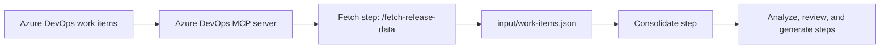

# Azure DevOps MCP

> **Project level:** Advanced
>
> **Time to complete:** 60–90 minutes to read, plan, and document the connection
>
> **Prerequisites:** Complete the MCP lesson in Module 10 · AI, the Release notes automation project in this module, and the Protect credentials section of the MCP lesson.

---

## Project goal

Most documentation workflows depend on information that lives in another system. For a release, that information is in the work-item tracker. An AI tool can only use that information if it can reach it, and the connection must be safe, limited, and documented.

In this project you will document and check the **Azure DevOps MCP** connection that the AI Release Note Generator uses. The connection is implemented. It lets the `/fetch-release-data` step read work items from Azure DevOps. Your job is to describe the connection clearly enough that a reviewer can decide whether to approve it, and to show how you check the data it returns.

You will not need to publish credentials or server settings. The point is the documentation, the limits, and the checks.

---

## Learning objectives

After you complete this project, you will be able to:

- Describe an MCP connection by its status, purpose, client, data read, data changed, owner, and credential location.
- Separate a connection that is implemented from one that is planned, and describe each correctly.
- Explain why a read-only connection is the safer default for a documentation workflow.
- Add a check to a workflow step that depends on an external source.
- Explain how to handle an expired token, a permission error, and an empty result.
- Keep credentials and private work-item data out of the repository and out of public pages.

---

## Where the connection fits

The release-note workflow reads work items in one step. Every other step works from files that step produces.

Because the output of the fetch step is a file, you can check it before any other step uses it. That separation is the main reason this connection is easy to govern.

---

## Connection status: implemented, and planned

The case study separates the connections that are live from those that are planned. Describe each one with its status, and do not describe a planned connection as if it works today.

| Connection | Status | How to describe it |
|---|---|---|
| Azure DevOps MCP | Implemented | The release workflow reads work items through it |
| ServiceNow MCP | Planned | Describe it as planned until it is connected |
| Other sources | Future | Do not describe them as available |

:::warning

A reader who tries a planned connection will fail, and will stop trusting the rest of the documentation. Check the status before every release of the docs.

:::

---

## Document the connection

Create a connection record in your project. Use the same fields as the MCP lesson, and answer every question. If you cannot answer one, the connection is not ready for the team.

| Item | What to write for this project |
|---|---|
| Status | Implemented |
| Purpose | Retrieve the work items for one release |
| Client | The AI tool that runs the fetch step |
| Data read | The work-item fields needed for release notes |
| Data changed | None in this workflow |
| Access owner | The team or role that approves access |
| Credentials | Stored in a secure location, not in the repository |
| Revocation | The steps to revoke the token or disable the connection |

:::note

Write "None" under Data changed only if you have confirmed it. Check the server's list of actions. A connection that can write to work items can change data that other teams rely on.

:::

---

## Prefer read-only access

Use the smallest set of permissions that the workflow needs. For release notes, the workflow needs to read work items. It does not need to create, edit, or delete them.

| Access level | Risk for this workflow | Recommendation |
|---|---|---|
| Read-only | Low: the workflow can see the data, but cannot change it | Use this for release notes |
| Read and write | Higher: a bug or a bad prompt could change work items | Do not use unless the workflow needs it |
| Administrative | High: can change projects and permissions | Do not use for this workflow |

Record the access level you chose and the reason for it in the connection record.

---

## Check the fetch step

An external source can fail in ways that are easy to miss. Add a check to the fetch step so that a problem is caught before the analysis starts.

### Check 1: Count the work items

Compare the number of work items in the output with the number listed in the release manifest. A difference means that some items were not retrieved, or that the manifest and the tracker disagree.

### Check 2: Sample the records

Open three or four work items at random. Confirm that the fields in the output match the fields in Azure DevOps. Look for missing titles, empty descriptions, and wrong states.

### Check 3: Look for internal detail

Scan the output for information that must not reach a customer draft, such as internal comments or system names. The output is a working file, so it can contain more detail than the published notes.

:::tip

Record each check in a table with the date, the number of items, the result, and the name of the person who checked. A record like this is useful evidence when a reviewer asks how the data was verified.

:::

---

## Handle failures

Each row below describes a failure that can happen with an external connection, what to check, and what to record. Test these cases with your own connection, and use a test account for any demonstration.

| Failure | What you see | What to check | What to record |
|---|---|---|---|
| Expired or revoked token | The fetch step fails with an authentication error | Whether the token has expired, and whether it was revoked | The date, the error message, and the fix |
| Insufficient permission | Some or all work items are missing | Whether the account can read the project and the work-item types | The missing item types and the permission change |
| Empty result | The output file has no work items | The release tag, the project name, and the query | The input you used, and the result |
| Partial result | The count is lower than the manifest | Whether some items were moved, closed, or filtered | The difference, and the decision you took |

:::warning

Do not paste an error message that contains a token, account name, or internal URL into a public page or a commit. Remove the sensitive parts first.

:::

---

## Protect credentials and data

| Rule | Reason |
|---|---|
| Store tokens in a secure location outside the repository. | A token in a file can be shared or committed. |
| Use a test account for demonstrations. | A test account limits the data that can be exposed. |
| Keep work-item output out of public pages. | Work items can include internal details. |
| Revoke a token that was exposed, before you remove it from the repository. | Git keeps the token in the history, even after the file is deleted. |

---

## Project steps

### Step 1: Write the connection record

Create the connection record using the table in this page. Keep it in your project folder, not in the repository's secret or configuration files.

### Step 2: Define the access level

Choose read-only access, and write one sentence that explains why it is enough for the workflow.

### Step 3: Map the fetch step

Write the input, the MCP call, the output, and the check for the fetch step, using the table format from the MCP lesson.

### Step 4: Design the checks

Write the three checks: the count check, the sample check, and the internal-detail check. For each one, write the expected result and what to do if the result is different.

### Step 5: Document the failures

Complete the failure table for your own connection. For each failure, write the symptom, the first thing to check, and the record you keep.

### Step 6: Review the record

Ask a reviewer to read the connection record and answer three questions: what does the connection read, what does it change, and who approves it? If the reviewer cannot answer, improve the record.

---

## What to show in your portfolio

- The connection record, with status, purpose, data read, data changed, owner, and credential location
- The access-level decision and its reason
- The fetch-step diagram and the three checks
- The failure table, with one failure you tested
- One sentence on why a read-only connection is the safer default

---

## Summary

A connection to an external system is a governance decision as well as a technical one. Documenting the status, the access, the checks, and the failures makes the connection something a team can review and trust. The Azure DevOps MCP connection is a good example because it is implemented, it is limited to reading, and its output is a file that can be checked before the next step uses it.

---

## Next Lesson

[Documentation Assistant](Documentation-Assistant.md)
