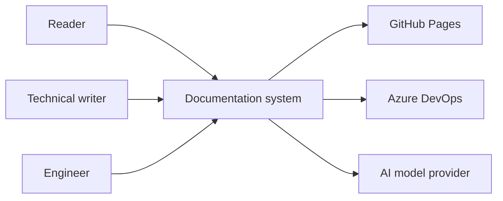
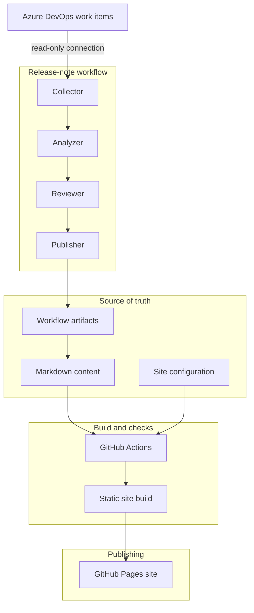
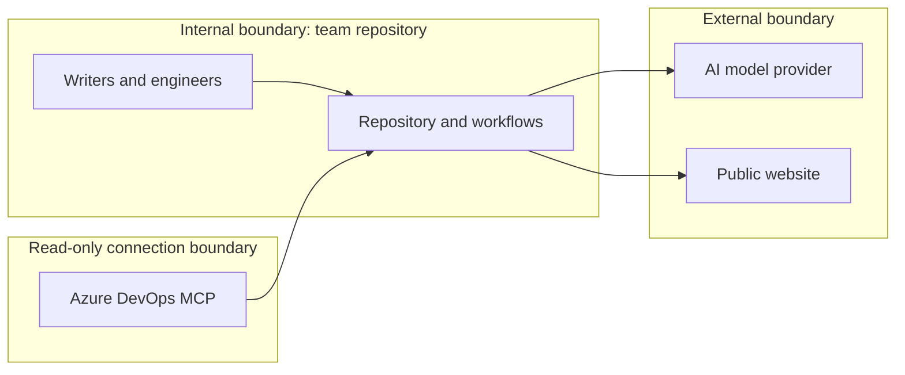

# Complete architecture

> **Project level:** Advanced
>
> **Time to complete:** 120–180 minutes to read, draw, and document the architecture
>
> **Prerequisites:** Complete the Release notes automation, Azure DevOps MCP, and Documentation assistant projects in this module, the Docusaurus Documentation Architecture page in the portfolio, and ADR 001 and ADR 002.

---

## Project goal

Each project in this module solves one part of the problem. A complete architecture shows how the parts fit together, what depends on what, where people make decisions, and which parts are finished and which are not.

In this project you will document the architecture of a complete documentation system. You will use the repository in this course as the worked example. You will then apply the same method to your own team or project, using sample data.

By the end, you will have a set of diagrams and decision records that a new team member could read in one sitting, and that an architect could review without asking you for context.

---

## Learning objectives

After you complete this project, you will be able to:

- Draw a system context diagram that shows the people and systems around a documentation platform.
- Show the main containers, such as the source repository, the build, the publishing site, and the AI workflow, and the data that moves between them.
- Mark each part as implemented, planned, or future, and describe each one accurately.
- Identify the trust boundaries, where data moves from one system to another, and the controls at each boundary.
- Document the decisions behind the architecture, using short decision records.
- Explain the architecture to a technical reviewer and to a non-technical manager.

---

## The worked example

The example system has four parts. Each one is documented in the portfolio or in this module.

| Part | What it does | Status in the repository |
|---|---|---|
| Documentation site | Builds the Learning Hub and the Documentation Portfolio from Markdown, and publishes them to GitHub Pages | Implemented |
| Release-note workflow | Collects release data, analyzes it, reviews it, and drafts customer and technical release notes | Implemented as a proof of concept, with Azure DevOps connected through MCP |
| Azure DevOps connection | Reads work items for the release workflow | Implemented, read-only in this workflow |
| Documentation assistant | Finds gaps between records and documentation, and drafts updates | Designed as a pattern, not implemented in this repository |

:::warning

Do not describe a planned part as working. The documentation assistant in this module is a design pattern, and ServiceNow is a planned connection. A reader who expects a working integration and does not find one will lose trust in the whole architecture.

:::

---

## Level 1: System context

A system context diagram shows the system as one box, with the people and external systems around it. It answers the question: what does this system connect to?

Each arrow is a relationship you must be able to explain. For the AI model provider, you should also document what data leaves the system and what the provider is allowed to keep.

---

## Level 2: Containers

A container is a separately deployed or separately run part, such as a website, a script, a pipeline, or a data store. The diagram below shows the main containers and the artifacts that move between them.

The arrow from the workflow artifacts back to the Markdown content is the most important one to document. It means the AI output is written to a file that a person reviews and commits. It does not go straight to the published site.

---

## Trust boundaries

A trust boundary is a point where data moves from one system to another, or from one level of permission to another. Each boundary needs a control, and the control must be written down.

| Boundary | Data that crosses it | Control |
|---|---|---|
| Work-item connection | Work-item fields, read-only | Read-only access, a dedicated account, and a documented owner |
| AI model provider | Prompts and selected records | Remove personal data first, and document the provider's data terms |
| Public website | Approved content only | A human approval step, and a build that fails on broken links |

:::important

Customer cases and internal comments are the highest-risk data in this system. Decide before you build which fields are allowed to leave the source system, and remove the rest.

:::

---

## Implemented, planned, and future

Your architecture document must mark the status of every part. Use three labels only.

| Label | Meaning | Example in this architecture |
|---|---|---|
| Implemented | Built and used today | The documentation site build and the Azure DevOps read connection |
| Planned | Approved, not built | ServiceNow connection, once the team approves it |
| Future | An idea, not yet approved | Multilingual publishing from the documentation assistant |

Put the label next to each box in your diagrams, or in a status table beside them. A diagram with no status labels makes every part look finished.

---

## Quality gates

A complete architecture shows where quality is checked, and by whom. No single check catches everything.

| Gate | What it checks | Who or what runs it |
|---|---|---|
| Git history | Every change is recorded | Git |
| Pull request review | The change is reviewed | A person |
| Build | The site builds, and broken links fail the build | GitHub Actions |
| Repository validation | Required files and folders exist | A validation script, run locally and in CI where configured |
| AI review | Draft quality is assessed as an input | An AI reviewer, as a report |
| Human approval | The publication decision is made | A person |

:::note

Be exact about what each gate does not check. For example, a successful build does not prove that a sentence is accurate, and a passing structure check does not prove that a release note is complete.

:::

---

## Decisions behind the architecture

Each important choice needs a decision record. Use the same short format as ADR 001 and ADR 002: the context, the decision, the alternatives, and the consequences.

| Decision | Choice | Why it matters |
|---|---|---|
| Source of truth | GitHub and Markdown, not the publishing platform | The publishing tool can change without losing content or history |
| AI publication | Human approval is required | AI can assist, but it does not authorize publication |
| Work-item access | Read-only | A workflow that only reads cannot change the records it depends on |
| Publishing tool | Docusaurus, with the architecture kept open to others | The approach is not tied to one tool |
| Documentation assistant | Designed, not built, in this repository | Keeps the public record accurate about what works today |

Write one decision record for each row that matters in your own system. A decision without its reasons is hard to review and easy to reverse by mistake.

---

## Failure modes

A complete architecture also describes what happens when a part fails. Document at least these three cases.

| Failure | What the reader or team sees | What the architecture does |
|---|---|---|
| The work-item connection fails | The fetch step stops, and no new release data is produced | The workflow stops before analysis, so no draft is built on partial data |
| The build fails on a broken link | The site is not updated | The previous published version stays live |
| The AI reviewer raises a problem | The draft goes to a human with a report | The draft is not published until a person approves it |

:::tip

For each failure, write the first person who should be told, and the record that should be kept. A failure with no owner is a failure that nobody fixes.

:::

---

## Project steps

### Step 1: Write the system context

Draw the system context diagram for the worked example. List every external system and every person who uses the system. For each arrow, write one sentence on what crosses it.

### Step 2: Draw the containers

Draw the container diagram. Label each container as implemented, planned, or future. Mark each artifact that moves between containers with its file name.

### Step 3: Mark the trust boundaries

Draw the trust boundaries. For each boundary, write the data that crosses it and the control that applies.

### Step 4: Write the decision records

Choose three decisions from the table above. Write a short record for each one, using the ADR format. Check each record against the repository, and make sure every claim is true today.

### Step 5: Document the failure modes

Complete the failure table with at least three rows. Name the owner of each failure.

### Step 6: Apply the method to your own system

Choose a team or project you know, and repeat steps 1 to 5 with sample data. Replace the internal details with generic labels, such as "Work-item system" or "Team repository." Do not include real names, systems, or screens if the system is confidential.

### Step 7: Review with a second reader

Give the architecture to a colleague who did not write it. Ask them to answer three questions: what does the system connect to, which parts are finished, and who approves publication. If they cannot answer, improve the diagrams and the labels.

---

## What to show in your portfolio

- The system context and container diagrams, with status labels
- The trust-boundary diagram and the controls table
- Three decision records, in the same format as ADR 001 and ADR 002
- The failure-mode table, with owners
- A one-page summary that a reviewer can read in five minutes

:::note

If the system is from your work, describe the method and the decisions in general terms. Do not publish a real architecture diagram, system name, or data flow without your employer's written approval.

:::

---

## Common mistakes

| Mistake | Why it matters | What to do instead |
|---|---|---|
| Drawing planned parts as if they work | Readers will try them and fail | Label every part with its status |
| Showing every tool in one diagram | The diagram becomes unreadable | Use a context diagram, then a container diagram, and keep each one small |
| Leaving out the trust boundaries | Data risks are hidden | Draw every boundary where data changes owner |
| Writing decisions without reasons | Future readers cannot judge whether a decision still holds | Record the context and the alternatives |
| Calling a build a quality check of content | A build checks structure, not meaning | Describe each gate exactly |

---

## Summary

A complete architecture makes a documentation system understandable and reviewable. The worked example combines a published site, a read-only work-item connection, an AI workflow with human approval, and automated checks. The most useful parts of the architecture are the status labels, the trust boundaries, and the decision records, because they show what is true today and why.

---

## Next Lesson

[ServiceNow MCP](ServiceNow-MCP.md)
