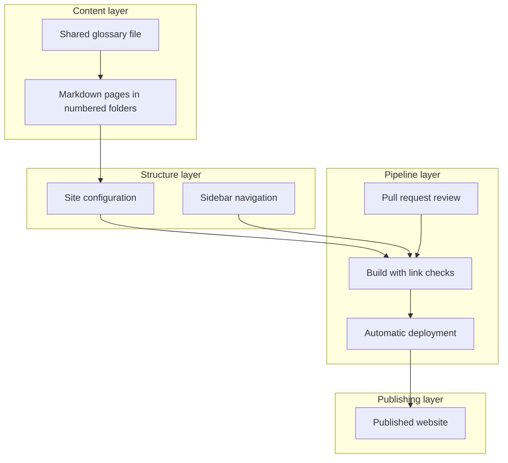
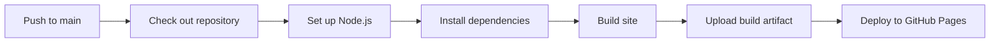

# Docs-as-Code project

> **Project level:** Advanced
>
> **Time to complete:** 6–8 hours across several sessions
>
> **Prerequisites:** Complete Modules 1 to 8, the Docs-as-Code Workflow module, and the Automation module (Module 11). Read the Docusaurus Documentation Architecture page in the portfolio before you start.

---

## Project goal

A documentation site is only useful if it stays accurate, is easy to change, and publishes reliably. A Docs-as-Code project makes those qualities a property of the process, not of one person's effort. The content lives in Git, the build checks it, and the pipeline publishes it.

In this project you will build a documentation site from an empty repository to a published website. You will use the same approach as the Start Docs-as-Code with Me site. Your site can cover any product, process, or topic you choose. Use your own content, or a made-up product with sample data, so that you can publish it without restrictions.

By the end, you will have a live site, a repository that another person could contribute to, and a short guide that explains how the site is built and checked.

---

## Learning objectives

After you complete this project, you will be able to:

- Set up a documentation repository with a clear structure, a README, and a contribution guide.
- Configure a static site generator for a project site on GitHub Pages.
- Organize content into numbered folders and a navigation structure that matches the reader's tasks.
- Write a build-and-deploy workflow that runs on every merge to the main branch.
- Use the build as a quality gate, so that broken links and format errors fail before publication.
- Document the review process and the publishing process for other contributors.

---

## What you will build

The finished project has four layers, each one with a clear job.



Each layer can change without rewriting the others. The content can stay the same while you change the theme, and the pipeline can change without touching the pages.

---

## Step 1: Define the audience and the purpose

Before you create any file, write two sentences: who the site is for, and what they should be able to do after reading it. Keep both sentences in the project's README.

| Question | Example answer for a sample project |
|---|---|
| Who reads the site? | New users of a sample product, and their support team |
| What should they do after reading? | Complete the first setup, and find the answer to the three most common errors |
| What is out of scope? | Pricing, internal planning, and any content that changes weekly |

:::tip

A clear purpose decides what goes in the navigation. If a page does not help the reader complete one of the tasks in your purpose, put it in a reference section or leave it out.

:::

---

## Step 2: Set up the repository

Create a public or private repository on GitHub. Add these files at the start, before any content:

| File | Purpose |
|---|---|
| README.md | Project purpose, how to run the site locally, and how to contribute |
| .gitignore | Keeps dependency folders and build output out of Git |
| LICENSE or a usage note | States how the content may be reused |
| CONTRIBUTING.md | Explains the branch, commit, and review process |

Use a short branch name for each change, such as `docs/setup-guide`, and merge changes to `main` through a pull request. The main branch should always be the version that is published.

---

## Step 3: Choose and configure the site generator

This project uses Docusaurus, as the course does. The choice is an implementation decision. The content structure you learn here can move to another generator, such as MkDocs or Mintlify, with the same Markdown and Git workflow.

Configure these settings in the site configuration file before you publish:

| Setting | What to set | Why it matters |
|---|---|---|
| Site URL | The address of the published site | Links and the sitemap depend on it |
| Base URL | The repository name, for a project site on GitHub Pages | Without it, the styles and links break on the published site |
| Broken link handling | Set to fail the build | A broken link should stop publication, not reach readers |
| Editing link | The address of the repository's main folder | Readers can suggest changes from any page |
| Markdown handling | Mermaid diagrams enabled if you use them | Diagrams stay in the source as text |

:::warning

If the base URL does not match the repository name, the published site can load without its styles or with broken navigation. Check the published address, not only the local preview.

:::

---

## Step 4: Structure the content

Organize the content into numbered folders. Each folder is one part of the learning path or the product guide, and its number sets the order in the navigation.

```text
docs/
├── 00-Overview
├── 01-Setup
├── 02-Core-Tasks
├── 03-Reference
└── glossary
```

Use these rules for the structure:

- Give each folder a README that states its purpose and lists its pages.
- Keep one topic on one page. If a page covers two tasks, split it.
- Keep shared terms in one glossary file, and link to it from the pages. Do not define the same term on several pages.
- Use the same heading pattern on each page: purpose, prerequisites, steps, and a next-step link.

:::important

When you move a page, check every link that points to it. The build will catch most broken links, but only if the link check is enabled.

:::

---

## Step 5: Write the content standards

Write a short standards page for contributors. It should cover the points below, and each point should have an example.

| Standard | Example rule |
|---|---|
| Plain language | Use short sentences, and define each term the first time it appears |
| Placeholders | Put placeholders such as tokens or paths inside code blocks, never in plain prose |
| Angle brackets | Do not write a bare less-than sign followed by a number or word in prose. Write the words instead. |
| Diagrams | Use Mermaid for workflows, and label each node clearly |
| Examples | Use sample data only, and never a real credential |
| Status | Label planned or unfinished features as planned, never as available |

The angle-bracket rule matters because the site generator reads Markdown and MDX. A bare less-than sign before a number can break the page during the build.

---

## Step 6: Build the deployment pipeline

Create a workflow file in the repository. The workflow should run on every push to the main branch, install the dependencies, build the site, and deploy it to GitHub Pages.

The job steps follow this pattern:



Keep these settings in the workflow:

| Setting | Why |
|---|---|
| Trigger on the main branch only | Only approved content reaches the published site |
| Only the permissions the deployment needs | Limits what the workflow can change |
| A concurrency group for the pages deployment | Prevents two deployments from overwriting each other |
| A separate build job and deploy job | The deploy job runs only if the build passes |

Test the workflow by making a small, visible change on a branch, opening a pull request, merging it, and checking the published page. Do not test on real content.

---

## Step 7: Add quality checks

The build is the first quality gate. Add checks in layers, so that each one catches a different kind of problem.

| Check | What it catches | Where it runs |
|---|---|---|
| Build | Broken links and Markdown syntax errors | The pipeline, on every merge |
| Link check | Links to missing pages or anchors | The build, or a separate step |
| Spelling check | Typos and unknown terms | The editor, with a project word list |
| Structure check | Missing required files or folders | A script, run locally and in the pipeline |
| Human review | Accuracy, tone, and whether the content helps the reader | A pull request review |

:::note

Be exact about what each check proves. A successful build shows the site is structurally valid, not that every instruction works. Keep human review for accuracy.

:::

---

## Step 8: Document the review and publishing process

Write a short guide that answers three questions for any new contributor:

1. How do I propose a change? Answer: create a branch, edit the page, and open a pull request.
2. Who reviews it, and what do they check? Answer: name the reviewer role and the checklist.
3. What happens after the merge? Answer: the pipeline builds the site and publishes it automatically.

Keep the guide next to the README. A process that is written down is easier to follow, and easier to improve.

---

## Optional extensions

The Start Docs-as-Code with Me site does not yet have these features. They are good extensions for your project, and you should describe them as planned until you build them.

| Extension | What it adds | Status in the course site |
|---|---|---|
| Site search | Lets readers find pages by keyword | Not configured |
| Documentation versions | Keeps old releases available to readers | Not configured |
| Lint and spelling checks in the pipeline | Runs the checks on every merge, not only in the editor | Editor checks only |
| Translation workflow | Publishes the site in more than one language | Designed in the Documentation assistant project, not built |

---

## Project steps

### Step 1: Write the purpose

Write the audience and purpose sentences in the README.

### Step 2: Create the repository

Create the repository, add the files in the table, and make the first commit on a branch. Merge it through a pull request.

### Step 3: Configure the site

Set the site URL, base URL, link handling, and editing link. Build locally and fix every warning that points to a broken link.

### Step 4: Build the structure

Create the numbered folders, a README in each folder, and the glossary file. Add at least six pages across at least three folders.

### Step 5: Write the standards

Write the content standards page with an example for each rule. Apply the rules to every page you wrote.

### Step 6: Create the pipeline

Add the workflow file. Make a visible change on a branch, merge it, and confirm the published page.

### Step 7: Add the quality checks

Run the build locally, then add a structure check script. Record the result of each check in a short table.

### Step 8: Write the contribution guide

Write the review and publishing guide. Ask a colleague to follow it and report the steps they found unclear.

---

## What to show in your portfolio

- The live site address, and a short description of its purpose
- The repository structure, with the numbered folders
- The pipeline diagram and the workflow file
- The quality-check table, with one example of a problem the build caught
- The contribution guide, and the feedback from the colleague who tested it

:::tip

Include one failure in your portfolio, with the fix. A build that failed on a broken link, and the commit that fixed it, shows more about your process than a clean history does.

:::

---

## Common mistakes

| Mistake | Why it matters | What to do instead |
|---|---|---|
| Publishing without a base URL check | The published site loses its styles | Check the live address after each deploy |
| Letting the build ignore broken links | Readers reach dead pages | Set broken links to fail the build |
| Defining the same term on several pages | The definitions drift apart | Keep one glossary and link to it |
| Describing optional features as working | Readers look for features that do not exist | Use "planned" until the feature is built |
| Committing a real credential in an example | The credential is in the history, even after deletion | Use a placeholder inside a code block, and revoke any exposed credential |

---

## Summary

A Docs-as-Code project turns documentation into a product with a repository, a review process, a build, and a publishing pipeline. You will learn the most by building the whole chain once: the structure, the configuration, the pipeline, and the checks. A site that is small, accurate, and published automatically is a stronger project than a large site that no one can maintain.

---

## Next Lesson

[Portfolio development](Portfolio-Development.md)
