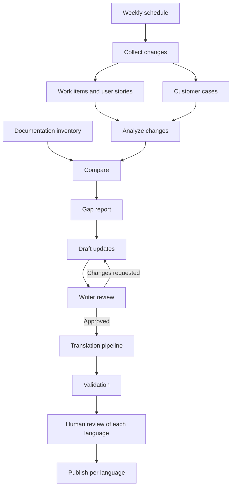
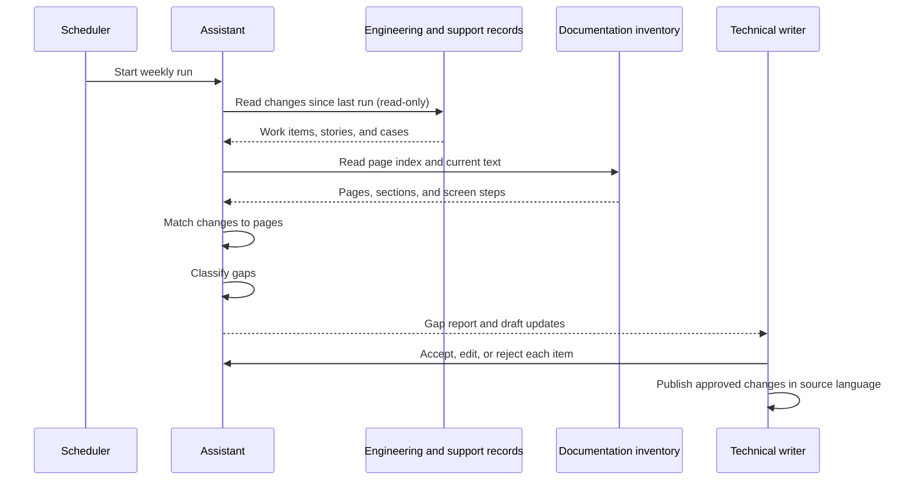
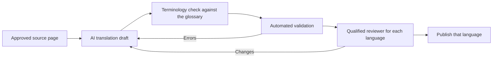

# Documentation assistant

> **Project level:** Advanced
>
> **Time to complete:** 90–120 minutes to read, plan, and run the sample walkthrough
>
> **Prerequisites:** Complete the Release notes automation and Azure DevOps MCP projects in this module, the Agentic AI and AI Governance lessons in Module 12 · AI for Technical Writers, the Translation lesson in Module 12, and the Validation and Link checking lessons in Module 11 · Automation.

---

## About this project

This project teaches a design pattern. It shows how a documentation team can use agents to find what has changed, which pages are now wrong, and what needs updating, while people stay in charge of what gets published.

Every example in this page is **sample data**. The work IDs, case numbers, page titles, and screens are invented for teaching. The page does not describe any organization's systems, and it does not use internal screens. If you adapt the pattern for your own team, keep the real data and screens inside your organization, and remove personal data before any text reaches an AI tool.

---

## Project goal

Technical writers spend a lot of time on tasks that have nothing to do with writing: finding out what changed, checking which pages describe the old behavior, and collecting the details from several systems. This project shows how an assistant can do the collection and comparison, so that writers spend their time on the review and the writing.

The assistant does five jobs:

1. **Collect** changes from engineering and support records, such as work items, user stories, and customer cases.
2. **Compare** those changes with the current documentation.
3. **Identify gaps**, such as outdated steps, missing features, and pages to remove.
4. **Draft** proposed updates, including updated UI steps.
5. **Route** each draft to a writer, and after approval, send it through translation and validation.

The assistant does not publish anything.

---

## Learning objectives

After you complete this project, you will be able to:

- Describe the weekly workflow of a documentation assistant, from collection to publication.
- Classify a documentation gap by type, and choose the right action for each type.
- Compare a change record with a documentation page, and explain what counts as a match.
- Design a review step for UI changes that does not depend on the agent's description alone.
- Plan a translation and validation pipeline that keeps a human reviewer for customer-facing text.
- Apply data-minimization and access rules to a workflow that reads customer records.

---

## The weekly workflow

The assistant runs once a week. Each run produces a gap report, and a writer reviews the report before any draft is written into the documentation.



Every stage writes an artifact that a writer can open. If a draft is wrong, you can trace it back through the gap report to the change record that caused it.

---

## Sequence of one weekly run



The assistant only reads the records. It writes its output to a report and a draft folder. The writer decides what moves forward.

---

## Gap types and the action for each

The gap report should classify every finding, so that a writer knows what kind of work it needs.

| Gap type | What it means | Example in sample data | Action |
|---|---|---|---|
| Outdated | A page describes behavior that has changed | A step names a button that was renamed | Update the page |
| Missing | A new feature or option has no documentation | A new filter exists, but no page mentions it | Write a new section |
| Obsolete | A page describes a feature that was removed | A page covers a retired export format | Remove or redirect the page |
| UI change | A screen, label, or step sequence has changed | The order of two fields on a form was swapped | Update the steps and confirm the screen |
| Conflict | Two pages give different answers | Two pages list different limits for the same setting | Choose one source of truth, and fix the other |

:::note

Classify each gap before you draft a fix. A missing section and an outdated step need different work, and a removal needs a check that no other page links to the page.

:::

---

## Sample gap report

The sample below uses invented IDs and titles. It shows the level of detail a writer needs to decide quickly.

```text
Weekly gap report (sample data)
Run date: 2026-01-12   Records read: 42   Pages checked: 118

ID     Type      Page                       Source record     Proposed action             Confidence
G-014  Outdated  Set up notifications       WI-1087 (sample)  Update step 3 label         High
G-015  UI change  Create a project           Story US-203       Re-check screen, steps 2-4  Medium
G-016  Missing   Filters overview           WI-1101 (sample)  New section                 Medium
G-017  Obsolete  Legacy CSV export          WI-0990 (sample)  Remove or redirect          High
G-018  Conflict  Limits and quotas          Case C-552 vs page  Decide source of truth      Low

Status: all items need writer review. No page has been changed.
```

Notice what the report does not do. It does not say a page is correct or publishable. It proposes work, and it shows how confident the assistant is in each finding.

---

## UI screen updates need a stricter check

A written description of a screen can be wrong, and an agent that works from text alone can produce confident steps that do not match the product. For UI changes, use this rule:

> The steps are confirmed against the running product in a test environment, not against the work item or the agent's summary.

Use this checklist for every UI-related gap:

| Check | Question |
|---|---|
| Screen | Does the screen in the test environment match the step? |
| Label | Is each button or field name copied exactly from the screen? |
| Order | Do the steps follow the order a user sees? |
| Result | Does the expected result appear after the last step? |
| Screenshot | Is any screenshot from the test environment, with no personal or internal data? |

:::warning

Never use a screenshot from a live or production system in public documentation. Use a test environment with sample data.

:::

---

## Human review and approval

This project follows the same rule as the release notes project. The assistant can find, compare, and draft. It does not approve. A writer reviews each draft, and a person approves publication.

Record the decision for each gap:

| Decision | What to record |
|---|---|
| Accepted | The draft used, and the reviewer's name or role |
| Edited | What you changed, and why |
| Rejected | The reason, such as a wrong match or a duplicate |
| Deferred | The next review date |

These records let the team measure how often the assistant is right. If most rejections come from one gap type, improve that part of the workflow.

---

## Translation and validation

Once a source page is approved, it can move into the translation pipeline. The pipeline has more than one check, and no step replaces the human check for customer-facing text.



| Stage | What it checks | Who decides |
|---|---|---|
| AI translation draft | Produces a first version in each target language | The assistant proposes |
| Terminology check | Approved terms match the glossary | An automated check, reviewed by a writer |
| Automated validation | Links, formatting, and build succeed | The pipeline |
| Reviewer for each language | Meaning, tone, and accuracy in that language | A qualified reviewer |
| Publish | The language version goes live | A person approves |

:::important

Automated translation is a draft. A reviewer who reads the target language must check any text that customers read, especially warnings, legal wording, and instructions with safety impact.

:::

---

## Governance and data minimization

A documentation assistant reads records that can contain personal or sensitive information. Customer cases are the most sensitive source, so apply these rules before you build anything.

| Rule | Reason |
|---|---|
| Give the assistant read-only access to each source. | It can gather and compare, but it cannot change the records. |
| Use a dedicated service account, with access limited to the needed projects and record types. | It limits what the assistant can see. |
| Remove personal data from customer cases before any text leaves the source system. | Personal data should not reach an AI tool or a report. |
| Keep secrets and tokens in a secure store, never in the repository. | A token in a file can be shared or committed. |
| Keep an audit log of each run: what was read, what was produced, and who reviewed it. | You need to explain how a page was changed. |
| Set a retention period for reports and drafts. | Old drafts can hold data you no longer need. |

These rules come from the same governance principle as ADR-002: AI may assist, but it does not authorize publication.

---

## Set up a weekly run

The schedule is the simplest part of the design. On GitHub, a workflow can start the run each week. The example below is only a schedule. The steps that follow it are your own design.

```yaml
on:
  schedule:
    - cron: "0 6 * * 1"   # every Monday at 06:00 UTC
  workflow_dispatch:       # allows a manual run for testing
```

Use the manual trigger when you test. Do not wait a week to find out whether a change works.

---

## Project steps

### Step 1: Build the page inventory

List every page in a sample documentation set, with its title, its section headings, and the screens or steps it describes. Keep the list in a table. This is the list the assistant compares against.

### Step 2: Create sample change records

Write five to eight sample change records. Include one outdated step, one new feature, one removed feature, one UI change, and one conflict. Give each a fake ID, such as WI-2001, so that it is clearly sample data.

### Step 3: Map records to pages

For each change record, write the page it affects, or write "none" if no page is affected. Check your matches by hand. Note any record that you could not match, because unmatched records are often the most useful findings.

### Step 4: Classify the gaps

Assign each gap one of the five types. Write one sentence on why you chose that type.

### Step 5: Write the gap report

Use the sample report format above. Include the run date, the number of records read, the number of pages checked, and a status line that says no page has been changed.

### Step 6: Review a UI draft

Pick one UI-related gap. Confirm each step in a test environment, or in a clearly labeled mock screen. Record the result using the UI checklist.

### Step 7: Plan the translation step

Choose two target languages for your sample. For one approved page, write the translation steps and the reviewer role for each language. Identify which checks are automated and which need a person.

---

## What to show in your portfolio

Show the project with sample data only.

- The weekly workflow diagram and the sequence diagram
- The gap types table and the sample gap report
- One UI draft, with the checklist results and mock screens
- The approval record for at least one accepted, edited, and rejected gap
- The translation pipeline diagram and the reviewer roles
- The governance table, with one example of data removed before processing

:::note

If you want to describe your work experience with this kind of assistant, describe the approach in general terms, such as "a weekly assistant that compared engineering records with the documentation and drafted updates for writer review." Do not name the organization, its systems, its screens, or its data, unless the organization has approved the disclosure in writing.

:::

---

## Common mistakes

| Mistake | Why it matters | What to do instead |
|---|---|---|
| Using real customer cases in a public demo | It can expose personal or confidential information | Use sample cases with invented details |
| Publishing a screen capture from a live system | It can show internal data and unreleased features | Use a test environment or a labeled mock screen |
| Trusting the agent's description of a UI | The description can be wrong about labels or order | Confirm each step in the product |
| Sending a translation straight to publication | Machine translation can change meaning | Add a reviewer for each language |
| Letting the agent write directly to the documentation | It removes the human decision | Write drafts to a separate folder for review |

---

## Summary

A documentation assistant does the slow work of collecting, comparing, and drafting, and it leaves the decisions with people. The weekly run produces a gap report that tells a writer what to review. UI changes need a check against the product, and translations need a reviewer in each language. Keep the data minimal, the access read-only, and every decision recorded.

---

## Next Lesson

[Complete architecture](Complete-Architecture.md)
