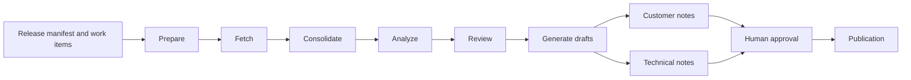
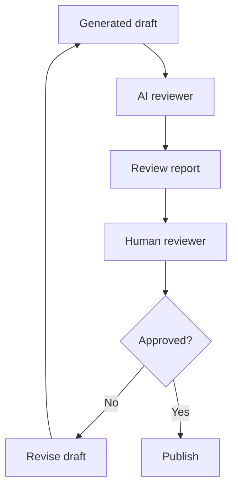

# Release notes automation

> **Project level:** Advanced
>
> **Time to complete:** 60–90 minutes to read, plan, and walk through the repository
>
> **Prerequisites:** Complete the Release notes and Agentic AI lessons in Module 12 · AI for Technical Writers, the AI Agents lesson in Module 10 · AI, and the Validation lesson in Module 11 · Automation.

---

## Project goal

Release notes are one of the most repeated tasks in technical writing. Each release needs a clear summary for customers, and a more detailed version for support and technical teams. Both drafts must match the engineering records, and both need a person to approve them before publication.

In this project you will study and rebuild the workflow behind the **AI Release Note Generator**, a documentation intelligence project in this repository. You will follow the same stages, the same artifacts, and the same approval boundary, and you will explain each decision in your own words.

By the end, you will have a project you can show in a portfolio: a workflow diagram, sample artifacts, two draft outputs, a review checklist, and a short explanation of the human approval step.

---

## Learning objectives

After you complete this project, you will be able to:

- Describe the stages of a release-note workflow, from source data to published draft.
- Explain why the customer and technical drafts come from the same analyzed data.
- Trace each draft back to the artifact it came from.
- Use an AI review report as an input to human review, not as the final decision.
- Run the repository validation step locally before you push a change.
- Present the project clearly to a hiring manager or a technical audience.

---

## What the project produces

The AI Release Note Generator is built as a sequence of stages. Each stage reads one artifact and writes the next. The table below uses the six commands documented in the project case study.

| Stage | Command | Input | Output | Who or what does the work |
|---|---|---|---|---|
| 1. Prepare | `/prepare-release` | Release tag and source | Release workspace and the Release Manager attachment | Preparation step |
| 2. Fetch | `/fetch-release-data` | Prepared release file | `input/work-items.json` | Collector Agent, with Azure DevOps MCP |
| 3. Consolidate | `/consolidate-release-data` | Manifest and work items | `collected-release-data.json` | Collector Agent |
| 4. Analyze | `/analyze-release-data` | Collected data | `analyzed-release.json` | Analyzer Agent, with deterministic metadata checks |
| 5. Review | `/review-release-analysis` | Analyzed data | `review-report.json` and `review-report.md` | Reviewer Agent |
| 6. Generate | `/generate-release-drafts` | Analyzed data and review context | `customer-release-notes.md` and `technical-services-release-notes.md` | Publishing Agent |

The case study notes that the ServiceNow integration is planned, not connected. Your version of this project should describe it the same way.

---

## The workflow



Each arrow is an artifact, not a hidden step. You can open any file in the chain and check what the next stage received.

---

## Two audiences, one source

The two drafts serve different readers, so they differ in content as well as in wording.

| Draft | Reader | Includes | Leaves out |
|---|---|---|---|
| Customer release notes | Customers and end users | Plain-language changes, fixes, and actions the reader should take | Internal IDs, system names, and technical internals |
| Technical services release notes | Support and technical teams | Component names, known issues, and technical impact | Marketing language, and details that do not affect support |

:::important

Keep internal identifiers, such as work item numbers, out of customer drafts. A customer does not need an internal ID, and the ID can expose information the team did not intend to publish.

:::

---

## The human approval boundary

The project follows **ADR-002: Human-in-the-Loop AI Review**. That decision says that AI-generated documentation must pass through both an automated review and a human review before publication. An AI reviewer can flag problems, but it does not approve publication.



The review report is a separate file. It does not change the draft silently. You should be able to point to the report and say which findings you accepted, which you rejected, and why.

> **Documentation Manager's tip**
>
> Ask the reviewer one question before approval: "What will this reader do differently after this release?" If the answer is nothing, the change may not need a release note. If the answer is clear, check that the draft says it.

---

## Project steps

Work through these steps in order. Keep notes as you go, because the notes become the explanation you present later.

### Step 1: Read the source material

Read the case study and the architecture pages in the repository:

- `portfolio/case-studies/ai-release-note-generator/index.md`
- `portfolio/architecture/ai-documentation-intelligence.md`
- `portfolio/adrs/adr-002-human-in-the-loop-ai-review.md`

Write down the five principles in the architecture and one sentence on what each one means in practice.

### Step 2: Map the artifacts

Draw the artifact chain yourself, without copying the diagram above. For each stage, write the input file, the output file, and the agent or component that produces it. Check your map against the case study table.

### Step 3: Work with mock data first

The project began with mock release data, and that approach is useful for learning. Mock data lets you test the workflow without access to a live engineering system. Create a small mock release with five to eight change records. Include at least one item that is internal only, one that is a bug fix, and one that is a known issue. Keep the data in a folder named clearly as mock data.

### Step 4: Write the two drafts

Using your analyzed data, write one customer draft and one technical services draft. Use the table in the previous section to check what each draft includes and what it leaves out. Then compare the two drafts. For each change, check that the customer draft does not reveal internal detail and that the technical draft gives support teams what they need.

### Step 5: Review with a checklist

Create a review checklist with these checks. Mark each one as passed, failed, or not applicable, and note the reason.

| Check | Question to ask |
|---|---|
| Accuracy | Does every statement match a source record? |
| Audience | Is the level of detail right for the reader? |
| Action | Does the reader know what to do, if anything? |
| Internal detail | Has any internal ID or system name leaked into the customer draft? |
| Terminology | Does the draft use the approved terms from the glossary? |
| Completeness | Is every change that affects the reader included? |

Use the AI review report as one input. If the AI reviewer raises a point that you disagree with, write down why.

### Step 6: Run the validation step

The repository includes a validation script that checks for the expected files and folders. Run it locally before you push any change:

```bash
python ci/validate_repository.py
```

In the case study, the same check runs in GitHub Actions after each push. A passing local run means the structure is correct. It does not mean the content is accurate. Content accuracy still depends on your review.

---

## What to show in your portfolio

Prepare these items so that someone can review the project in ten minutes:

- A workflow diagram that shows the six stages and the approval boundary
- The sample mock data and the artifact files it produced
- The two drafts, side by side
- Your review checklist, with one example of a finding you accepted and one you rejected
- A short written explanation of ADR-002 in your own words
- A screenshot or recording of the validation step passing

---

## Common mistakes

| Mistake | Why it matters | What to do instead |
|---|---|---|
| Sending the AI draft straight to publication | The publication decision is a human responsibility | Keep the human approval step in every version of the workflow |
| Copying internal IDs into the customer draft | It can expose internal information | Keep internal references in the technical draft only, if at all |
| Treating the AI review score as the final answer | The reviewer can miss context | Use the report as input, and record your own decision |
| Describing ServiceNow as connected | The case study lists it as planned | Say "planned" or "architecture" until it is connected |
| Skipping the local validation run | Structural errors reach the pipeline | Run the script before each push |

---

## Summary

Release notes automation shows how Docs-as-Code, AI assistance, and human approval can work together. The workflow is built from small stages with visible artifacts. Two drafts serve two audiences from one source. The review is layered, and the publication decision stays with a person.

This project is the first in Module 13. The next project connects the same kind of workflow to live work items.

---

## Next Lesson

[Azure DevOps MCP](Azure-DevOps-MCP.md)
