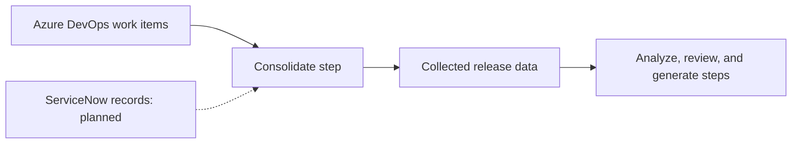

# ServiceNow MCP

> **Project level:** Advanced
>
> **Time to complete:** 90–120 minutes to read, scope, and write the connection plan
>
> **Prerequisites:** Complete the Azure DevOps MCP and Complete architecture projects in this module, the MCP lesson in Module 10 · AI, and the AI Governance lesson in Module 12 · AI for Technical Writers.

---

## Status of this connection

:::warning

**Planned, not connected.** The ServiceNow connection is documented in the case study as architecture or future integration. It is not implemented. Do not describe it as working in a portfolio, a demo, or a presentation until it has been built, tested, and approved.

:::

This project does not build the connection. It teaches you how to decide whether a connection should be built, what it may read, what it must never do, and what evidence the team needs before the status can change from planned to implemented.

---

## Project goal

Customer cases and service records often hold the most useful information for release notes and documentation updates. A case shows which step confused a customer, which error appeared in production, and which fix a customer needed. A documentation team that can read those records can write better content.

The same records also contain the most sensitive data in the system. A connection to them must be planned with care. In this project you will write a connection plan that answers three questions before anyone writes code:

1. What data would this connection read, and why does the workflow need it?
2. What data must the connection never read or send onward?
3. What evidence would show that the connection is safe to move from planned to implemented?

---

## Learning objectives

After you complete this project, you will be able to:

- Explain the difference between a planned and an implemented connection, and describe each one accurately.
- Define the minimum data a documentation workflow needs from a service-record system.
- Apply data minimization, so that personal and confidential fields are removed before any AI processing.
- Write a read-only connection plan with an owner, an access limit, and a revocation process.
- Define acceptance criteria that must be met before a planned connection is marked implemented.
- Describe a planned connection to a non-technical reader without overstating it.

---

## Where ServiceNow fits

The release-note workflow reads its work items through the Azure DevOps connection. The case study describes ServiceNow data as an optional input to the consolidation step, used when it is available.

The dotted line is the important detail. It shows that the connection is not part of the working flow today. A reader should be able to see the planned status from the diagram alone.

---

## What the workflow would need

Start with the question a writer would ask the data: "What would change in the documentation if I had this record?" Then decide the smallest set of fields that answers that question.

| Record type | Possible use in documentation | Minimum fields to consider | Fields to exclude |
|---|---|---|---|
| Customer case | Find the steps that confused customers, and the errors they reported | Case category, product area, resolution summary, date | Customer name, contact details, account identifiers, free-text personal notes |
| Known issue | List known problems in release notes | Issue title, affected version, workaround | Internal notes about cost, staffing, or customer names |
| Incident | Identify errors to document in troubleshooting pages | Error category, affected component, resolution | Any field with personal or customer-identifying data |

:::important

Decide the fields before you decide the connection. If you cannot name the field a documentation task needs, do not ask for it. A connection that reads everything is harder to govern and more likely to expose data.

:::

---

## Data minimization rules

These rules apply before any record leaves the source system, and before any text reaches an AI model.

| Rule | Reason |
|---|---|
| Read only the fields in your minimum list. | Fields you do not read cannot leak. |
| Remove personal and customer-identifying data at the source, or in a step before analysis. | The AI workflow should never receive personal data it does not need. |
| Summarize free text only after personal details are removed. | Free text is where personal details often appear. |
| Do not send case data to an external AI provider without a documented data agreement. | Provider terms decide how the data may be stored and reused. |
| Keep case data out of public pages, demos, and portfolio screenshots. | Customer cases are confidential by default. |

---

## The connection plan

Write one record for the planned connection. Use the same fields as the Azure DevOps record, and mark the status as planned.

| Item | What to write |
|---|---|
| Status | Planned |
| Purpose | Read service records that add context to release notes and documentation gaps |
| Client | The workflow step that would read the records |
| Data read | The minimum fields from the table above |
| Data changed | None. The connection is read-only. |
| Data removed before use | The personal and customer-identifying fields, and where removal happens |
| Access owner | The team or role that approves the account and its scope |
| Account type | A dedicated service account, not a personal account |
| Credentials | Stored in a secure location, never in the repository |
| Revocation | The steps to revoke the account and disable the connection |
| Review date | The date the plan is next reviewed |

:::note

A plan is not a promise that the connection will be built. Record the business reason clearly, so that a reviewer can decide whether the benefit justifies the risk.

:::

---

## Acceptance criteria for "implemented"

A planned connection changes status only when every criterion below is met and recorded. Write these criteria before you build, so that nobody can move the status without evidence.

| Criterion | Evidence to keep |
|---|---|
| Access is read-only, verified against the account's permissions | A permissions review, with the date and the reviewer |
| Only the minimum fields are returned | A sample output, with personal fields confirmed absent |
| Personal data is removed before any AI step | A test showing the removal step and its result |
| The connection is tested with sample data first | A test record, and the result |
| The access owner has approved the scope | A signed approval, or a recorded approval in the team's process |
| A revocation test has been run | A record showing the connection was disabled and tested |
| The portfolio and documentation describe the status accurately | A review of the pages, with the date |

:::warning

Do not mark the connection implemented because the code runs. A connection can run correctly and still read too much data. The criteria above check safety, not only function.

:::

---

## Failure cases to plan for

Plan the failures before you build. The table below lists the common ones, with what to record and who to tell.

| Failure | What to check | What to record | Who to tell |
|---|---|---|---|
| The account is over-permissioned | The permissions review | The permission found, and its removal | The access owner |
| Personal data appears in the output | The sample output and the removal step | The field, the step where it appeared, and the fix | The access owner and the privacy contact |
| The connection stops returning records | The account status and the query | The error, the date, and the fix | The workflow owner |
| A planned connection is described as working | The documentation pages | The page, the correction, and the date | The documentation owner |

---

## Project steps

### Step 1: Restate the status

Write one sentence on the status of the ServiceNow connection, using the word "planned." Check that the same status appears on every page that mentions the connection.

### Step 2: List the documentation tasks

Write three documentation tasks that could use service records, such as finding unclear steps in customer cases or identifying known issues for release notes. For each one, write the question the task answers.

### Step 3: Define the minimum fields

For each task, list the fields you need. Remove any field that does not answer the task's question.

### Step 4: Mark the data to exclude

Write the list of fields you will not read, and the reason for each one. Include every personal and customer-identifying field you can find.

### Step 5: Write the connection plan

Complete the connection plan table. Keep it with your project, and do not put any credential or account name in the plan.

### Step 6: Write the acceptance criteria

Complete the acceptance criteria table. For each criterion, name the evidence you would keep.

### Step 7: Review with a privacy or governance reader

Ask a reader with governance responsibility to review the minimum fields and the exclusion list. Record the feedback, and change the plan where it is needed.

---

## What to show in your portfolio

- The planned status, stated on the first page of the project
- The minimum-field table and the exclusion list
- The connection plan, without any account name or credential
- The acceptance criteria table
- One failure case, and what you would record

:::note

Present this as a plan. Describing a planned connection as a finished feature is the most common way to overstate a portfolio project, and it is easy for a reviewer to spot.

:::

---

## Common mistakes

| Mistake | Why it matters | What to do instead |
|---|---|---|
| Describing the connection as working | Readers try it and fail | Use "planned" everywhere until the criteria are met |
| Asking for every field "in case it is useful" | Unneeded personal data increases risk | Ask only for fields that answer a named task |
| Sending case text to an AI tool without removing personal details | Personal data leaves the source | Remove personal details first, and document the step |
| Using a personal account for the connection | The account is hard to govern and revoke | Use a dedicated service account with a named owner |
| Marking the status complete because the code runs | A working connection can still be unsafe | Use the acceptance criteria |

---

## Summary

A planned connection is still a useful part of an architecture, as long as it is described honestly. The ServiceNow connection shows how a documentation team can plan access to sensitive service records: define the minimum fields, remove personal data early, keep the connection read-only, and set acceptance criteria before anyone builds it. The status changes only when the evidence says it should.

---

## Next Lesson

[Docs-as-Code project](Docs-as-Code-Project.md)
